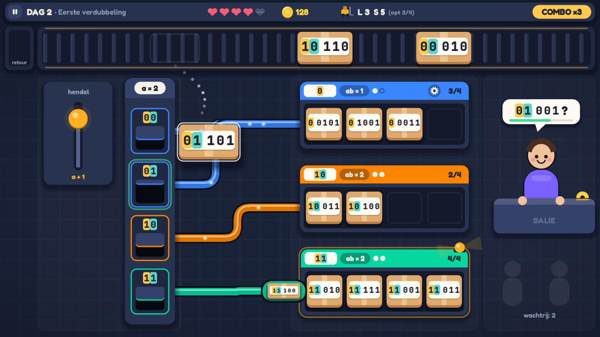

# Hash & Dash — Art & audio direction

> Eigenaar: art & audio director. Voor: gameplay-engineer (scènes, UI, juice) en QA.
> Referentiebeeld: `design/art_preview.png` (scène `res://scenes/art_preview.tscn`, code in
> `scripts/game/art_preview.gd`. Kopieer gerust helpers zoals `_sb()`, `_bits()`, `_fillet()` en `_draw_parcel()`).
> Assets: `assets/MANIFEST.md` (wat hoort bij welk event) · `assets/CREDITS.md` (licenties).
> De functionele eisen (wat moet bewegen, lettergroottes, layout) staan in `GDD.md`. Dit document bepaalt hoe het eruitziet en klinkt.

---

## 1. Stijl: "Night-shift depot", flat vector in code

**Keuze: optie (c), een mix, met code als basis.** Alles wat het spel *is* (pakjes, luiken, buizen, rekken, band,
klanten, HUD) tekenen we in Godot zelf: `StyleBoxFlat` met afgeronde hoeken en zachte schaduw, `Line2D` voor
buizen, `draw_*` voor iconen en figuurtjes, en één achtergrondshader. Kenney (CC0) levert alleen wat in code
lastig is: UI-iconen (wit, getint), een paar partikeltexturen en geluid.

Waarom zo:
- **Bitlabels zijn het belangrijkste element op het scherm.** Ze moeten scherp blijven op elke grootte (18–40 px)
  en per cijfer een kleurchip kunnen krijgen. Met tekst in code (mono-font, dynamische fontrendering) gaat dat
  pixelperfect. Bij sprites zou elk label een bitmap met vaste resolutie zijn.
- **Alles is dynamisch.** De muur verdubbelt, buizen bundelen en klappen om, en rekken splijten. Vectorvormen kun
  je vrij schalen, splijten en hertekenen zonder dat je per toestand een sprite nodig hebt.
- **Eén handschrift.** Kenney-packs onderling mengen (isometrisch + flat + pixel) oogt snel als een asset-flip.
  Eén vormtaal in code oogt bewust ontworpen, à la *Mini Metro* / *Overcooked*-UI.
- **Haalbaar zonder tekenaar**, en de engineer kan elke kleur of maat via constanten tweaken.

**Moodboard in woorden:** een postdepot tijdens de nachtploeg. Diepblauwe leisteenvloer met een subtiel
tegelraster. Warme kraftkartonnen dozen met crèmewitte stickers. Buizen als snoepgoed-gekleurde metrolijnen, met
een glanslijn erop. Geel-zwarte veiligheidsaccenten op de band. Oranje zwaailichten bij problemen. Ronde,
vriendelijke vormen, niets scherp. Het voelt als speelgoed van hoge kwaliteit: *tactiel, helder, warm tegen koel*.
Donkere achtergrond, zodat kleur en gloed (buis-pulsen, partikels) echt oplichten.

---

## 2. Palet

Alle kleuren staan als `const` bovenaan `scripts/game/art_preview.gd`. Zet ze in een autoload `Palette.gd` zodat
de hele game dezelfde waarden gebruikt.

### 2.1 Achtergrond & panelen (van ver naar dichtbij)
| token | hex | gebruik |
|---|---|---|
| `BG_DEEP` | `#121829` | vignetrand, timer-/combo-pillen, diepste laag |
| `BG` | `#1A2238` | vloer |
| `FLOOR_LINE` | `#212B45` | tegelraster 64 px (shader) |
| `ZONE` | wit 2,2 % + rand wit 5 % | zachte zonepanelen (band, muur, rekken, balie) |
| `PANEL_LO` | `#1F2840` | band-frame, luik-kader |
| `PANEL` | `#28334F` | muur, rekken, hendelkast, HUD |
| `PANEL_HI` | `#34416A` | kop van de muur, toonbank, knoppen, klepjes |
| `SLOT` | `#141A2B` | binnenkant van band/rek (verzonken) |
| `OUTLINE` | `#0B101C` | buis-buitenrand, donkere contouren |
| `SHADOW` | `rgba(5,8,20,.45)` | alle slagschaduwen |
| `TEXT` | `#F4F1EA` | tekst op donker (warm wit, niet puur #FFF) |
| `TEXT_DIM` | `#8D97B5` | secundaire tekst |

### 2.2 Bitposities (de belangrijkste kleuren van de game)
| positie | hex | naam |
|---|---|---|
| 1 | `#FFC94D` | goud |
| 2 | `#5CD6C8` | aqua |
| 3 | `#FF8FAB` | roze |
| 4 | `#A5E05A` | limoen |
| 5 | `#B39DFF` | lavendel |
| 6 | `#FFA463` | abrikoos |

- Positiekleuren zijn **chips achter het cijfer** (afgeronde rechthoek, radius 0,24 × fontgrootte). Het cijfer
  zelf blijft altijd **inkt `#1A1F2E`** op de chip. Zo haal je contrast ≥ 7:1 op elke chip, ook bij 18 px.
  Gekleurde cijfers op wit zouden voor goud en aqua onder 4.5:1 zakken.
- **Afwijking van GDD §5.1** (dat koraal/amber/mint/cyaan/lila/roze voorstelde): koraal `#FF6B6B` en mint
  `#3DDC97` botsen met onze semantische kleuren *fout* en *ok*. Een bitchip mag nooit lijken op "fout" of
  "goed". Daarom alleen pastelle, niet-semantische tinten, met een helderheid die op elkaar is afgestemd. Volgorde
  goud → aqua → roze wisselt warm/koel af, zodat buren altijd verschillen. `DaySpec.bit_hint`-niveaus:
  - `FULL`: chips op de eerste *a* bits + accolade eronder (2 px lijn in `TEXT_DIM`, of een witte accolade op de band).
  - `COLORS`: chips op alle bits (positiekleur), geen accolade.
  - `NONE`: geen chips, alleen inkt op de witte sticker (het label blijft leesbaar zonder kleur).
- Tussen bit *a* en bit *a+1* staat **0,3 × fontgrootte extra spatie** (de "knip"). Tussen de cijfers staat
  max(3 px; 0,12 × grootte). Mono-font = vaste kolombreedte (kleurenblind-veilig, GDD-eis).
- Luiklabels en rekbordjes gebruiken dezelfde chips. Het luik `01` toont een goud- en een aqua-chip, en het pakje
  `01101` heeft exact die twee chips vooraan. Dat is de visuele koppeling die de speler moet leren.

### 2.3 Emmers / rekken / buizen
Elke emmer (rek) krijgt bij creatie de volgende vrije kleur. Een nieuw rek na splitsen krijgt een **nieuwe** kleur.
Het oude rek houdt de zijne.
| idx | hex | | idx | hex |
|---|---|---|---|---|
| 0 | `#3A86FF` blauw | | 4 | `#8338EC` violet |
| 1 | `#FB8500` oranje | | 5 | `#00B4D8` cyaan |
| 2 | `#06D6A0` mint | | 6 | `#E056FD` magenta |
| 3 | `#EF476F` framboos | | 7 | `#FFD166` zand |
Met meer dan 8 rekken (a = 5–6) cyclen de kleuren. Verschuif de lichtheid dan ±12 % per cyclus.
De kleur verschijnt op: de buis (body = kleur 12 % donkerder, glanslijn = kleur 45 % lichter, buitenrand
`OUTLINE`), de kop van het rek, de rand van elk luik dat ernaar wijst en de stroom-puntjes. **Gedeelde pointers**
(2^(a−ab) luiken → één rek) lopen samen in één verzamelbuis. Tel de buizen = tel de pointers.

### 2.4 ab-niveau (lokale diepte)
- Op de kop van het rek: **bordje** (crème `#FFFBF2`) met het prefix (= de eerste ab bits) in positiechips, en
  daarnaast de badge `ab = k` (wit op zwart 28 %).
- **Dieptemeter**: *a* stipjes, waarvan *ab* gevuld (`TEXT`) en de rest hol (rand zwart 40 %). In één oogopslag:
  "nog lege stippen" = ab < a = zagen kan. "Alles gevuld" = ab = a = eerst de hendel.
- Zaagknop (rond, zwart 28 %, wit zaagblad) staat alleen op rekken met ab < a.
- Rek bijna vol (g−1): het bordje krijgt een rand in `WARN`. Vol + vastloper: een pulserende `WARN`-ring rond het
  rek plus een zwaailicht.

### 2.5 Semantisch
| token | hex | gebruik |
|---|---|---|
| `OK` | `#3DDC97` | doel-luik gloed, scanner "gevonden", geduldsbalk > 30 % |
| `WARN` | `#FFB020` | vol rek, zwaailicht, hendel-affordance, inspectielampje, veiligheidsstrepen |
| `ERR` | `#FF5A5F` | burst, geduld < 30 %, eindaanslag. **Spaarzaam**: nooit voor "fout antwoord"-tekst |
| `COIN` / `COIN_DARK` | `#FFD23F` / `#E09A1B` | munten, sterren, combo-pil |
| `HEART` | `#FF5A7A` | reputatiehartjes, blosjes van klanten |
| `INFO` | `#4CC9F0` | tutorial-spookhand, focusring bij toetsenbord |

### 2.6 Pakjes & figuren
| token | hex | |
|---|---|---|
| `KRAFT` / `KRAFT_DARK` | `#E0A96D` / `#B97F46` | doos / onderrand (8 % van de hoogte) |
| `TAPE` | `#F3DDB0` @ 55 % | verticale plakband (14 % breed) |
| `LABEL` | `#FFFBF2` | sticker (88 % × 54 % van de doos) |
| `INK` | `#1A1F2E` | alle cijfers |
| huidtinten | `#F2C29B` `#C68B59` `#8D5524` `#FFDBAC` | klanten (random) |
| kledij | kies uit de emmerkleuren 4–7 + `#7B61FF` | klanten. Nooit de kleur van een bestaand rek naast dat rek |

---

## 3. Typografie (`assets/fonts/`, beide OFL)
| rol | bestand | gebruik |
|---|---|---|
| **bits** | `JetBrainsMono-ExtraBold.ttf` | elk bitlabel (pakje, luik, bordje, ballon, typbuffer), timers, tellers met cijfers die niet mogen verspringen |
| bits (licht) | `JetBrainsMono-Bold.ttf`, `-Medium.ttf` | kleine labels (≤ 18 px), debug |
| **display/UI** | `Fredoka-Bold.ttf` | titels, HUD-waarden, knoppen, "COMBO ×3", "DASH!" |
| UI tekst | `Fredoka-SemiBold.ttf`, `Fredoka-Medium.ttf` | subtitels, labels, dagrapport-tekst |

- JetBrains Mono: hoge x-hoogte, een duidelijke **0 met stip** (nooit verwarring met O) en een 1 met vlag en voet.
  Ideaal voor binair.
- Fredoka: rond en vriendelijk, past bij de afgeronde vormtaal en is goed leesbaar in het Nederlands (ë, ï, é).
  Statische instanties gemaakt uit de variabele Google-font (wght 500/600/700, wdth 100).
- Groottes volgens GDD §7.1: band 40 · rek 26 · luik 28 (a ≤ 4) / 18 (a ≥ 5) · bordje 26 · ballon 36 · HUD 28.
  Titels 64–96 (Fredoka Bold). Nooit kleiner dan 18 px.
- **Pakjesmaat volgt uit het label**: bij 40 px is één cijfer 24 px breed, dus `10110` + chips + knip ≈ 150 px.
  Gebruik daarom een **pakje van 176 × 104 op de band** (in plaats van 120 × 80) en vakken van ~128 px breed in de rekken
  (pakje 114 × 104, label 26 px). Met 3 pakjes zichtbaar op de band past dat ruim.
- Tekst op donker: `TEXT`. Gebruik geen outline. Waar tekst over beweging zweeft (floaters "+10"): Fredoka Bold
  met `outline_size` 8 in `OUTLINE`.
- Theme: maak één `Theme` met `default_font = Fredoka-SemiBold`, `default_font_size = 24`. Knoppen gebruiken
  StyleBoxFlat volgens §4.

---

## 4. Vormtaal: hoeken, schaduwen, lijnen
Alles is een `StyleBoxFlat` met `anti_aliasing = true` en `corner_detail = 10`.
| element | radius | schaduw (size / offset) | extra |
|---|---|---|---|
| grote machines (muur, rek, band, hendelkast) | 22–26 | 16–20 / (0, 10) | kop in `PANEL_HI` of de emmerkleur, 58–64 px hoog |
| pakje | 13 % van de hoogte | 7 / (0, 6). Opgetild: 22 / (8, 22) | onderrand 8 % in `KRAFT_DARK` = dikte |
| sticker/bordje | 12–20 % van de hoogte | 2 / (0, 2) zwart 18 % | |
| knop | 18 | — | `border_width_bottom = 6` in kleur −35 % ("drukbaar"). Hover: 3 px omhoog |
| pil (HUD, combo, badge) | hoogte / 2 | — | |
| HUD-balk | 22 | 14 / (0, 6) | 97 % dekkend |
| selectie/gloed-ring | radius + 6 | — | `draw_center = false`, rand 4–5 px, alfa pulseert met sin(6t) |

- **Buizen**: drie `Line2D`'s op elkaar: rand 34 px `OUTLINE`, body 24 px, en een glanslijn van 6 px, 5 px hoger.
  `joint_mode = ROUND`, `antialiased = true`. Routes zijn orthogonaal met **afgeronde bochten van r = 40**
  (`_fillet()`). Geen diagonalen, behalve als animatie-tussenstand.
- **Lichtinval** komt van linksboven: glansvlekjes linksboven, slagschaduwen naar onderen.
- **Geen pure zwarte of witte vlakken** (behalve gaten in luiken `#06090F`).
- Iconen: Kenney *Game Icons* (wit, 100 px) via `modulate`/`self_modulate` in `TEXT` of `TEXT_DIM`.
  HUD-iconen zoals munt, hart, heftruck en ster zijn in code getekend: zie `_coin`, `_heart`, `_truck`, `_star`.

---

## 5. Layout-principes
- Volg de zones uit GDD §7.1: HUD 0–64 · band 84–224 · hendel | muur (400–560) | buizen | rekken (960–1500) | balie.
  Elke zone ligt op een zacht zonepaneel. De flow leest **links → rechts, boven → onder**, net als het algoritme
  (h(r) → index → pointer → emmer → opzoeken).
- **Ruimte rond de bits**: minstens 0,25 × fontgrootte padding rond elk label. Bitlabels overlappen nooit iets
  anders dan hun eigen pakje.
- Er is **één ding tegelijk dat oplicht** (GDD-tutorialstijl): affordance = gloed in `OK` (doel) of `WARN`
  (moet nu). Al het andere blijft rustig.
- Rekken staan in de volgorde van de pointerarray. Een gesplitst rek schuift **onder** het oude in, en de rest
  schuift mee (tween).
- Veilige marges: 16 px rond de rand en 24 px tussen zones. De HUD zweeft (afgeronde balk, niet tegen de rand
  geplakt).
- Bij krappe ruimte (a = 5–6) worden de luiken kleiner. Behoud dan de verhouding label : luik en ga niet onder
  18 px font.

---

## 6. Motion-principes (bindend voor alle tweens)
Godot-notatie: `tween.set_trans(...).set_ease(...)`.

| soort beweging | trans / ease | duur | overshoot |
|---|---|---|---|
| verschijnen (pop-in: ballon, knop, badge) | `TRANS_BACK` / `EASE_OUT` | 0,18–0,25 s | scale 0 → 1 (Back geeft ~10 %) |
| verdwijnen | `TRANS_QUAD` / `EASE_IN` | 0,12–0,15 s | geen. Verdwijnen is altijd sneller dan verschijnen |
| verplaatsen binnen het scherm (rek schuift, heftruck) | `TRANS_CUBIC` / `EASE_IN_OUT` | 0,3–0,45 s | — |
| landen (pakje op band/in vak) | `TRANS_BACK` / `EASE_OUT` | 0,12–0,15 s | squash (1,2; 0,8) → (1; 1) |
| klappen/scharnieren (luik, rek dicht) | `TRANS_QUAD` / `EASE_OUT`, terug met `TRANS_BOUNCE` | 0,10 + 0,20 s | — |
| buizen omzetten, hendel loslaten | `TRANS_ELASTIC` / `EASE_OUT` | 0,45 s | elastisch, 1 nazwaai |
| tellers (munten, ritten) | `TRANS_EXPO` / `EASE_OUT` | 0,4–0,8 s | pulse 1,15 → 1 bij aankomst |
| ademen/idle | `sin()` in `_process` | 2–4 s periode | amplitude ≤ 1 % schaal of ≤ 4 px |

Regels:
1. **Anticipatie & follow-through**: iets wat groot beweegt, deinst eerst 5 % terug (0,06 s) en schiet daarna 3–10 %
   door. Voorbeeld: muur verbreden: 24 px naar links, dan open.
2. **Staggering**: reeksen (luiken splijten, buizen omklikken, sterren) starten 30–60 ms na elkaar, nooit tegelijk.
3. **Squash & stretch behoudt het volume**: x × y ≈ 1.
4. **Slow-mo en hitstop** gelden alleen voor wereldnodes (een eigen `time_scale` per laag). UI-tweens lopen door.
5. **Schermschok**: alleen positie (geen rotatie), ruis-gebaseerd, met kwadratische decay. Max 10 px (burst),
   standaard 2–4 px. Gaat door de instelling 0 / 50 / 100 %.
6. Nooit lineaire tweens voor zichtbare objecten, behalve continue bewegingen (band, stroom in buizen).
7. Kleurflitsen: 1 frame wit (`modulate` 1,6) en dan 0,15 s terug. Nooit langer dan 0,2 s rood.
8. Totale "UI-latency": feedback op input binnen **1 frame** (geluid + visuele tik). De tween mag daarna komen.

---

## 7. Partikels (GPUParticles2D, of CPUParticles2D als de Compatibility-renderer hapert)
Alle texturen zijn **wit**. Kleur via `color` / `color_ramp`. Blend `add` voor licht en `mix` voor stof en karton.
| event | textuur | recept |
|---|---|---|
| stofwolkje bij aankomst in rek | `puff.png` | 6 st., 0,4 s, v 40–80 omhoog/zijwaarts, schaal 0,3 → 0,6, kleur `KRAFT` 60 % → 0 |
| munten-vonkjes | `sparkle.png` | 5 st., 0,35 s, v 120, `COIN`, add |
| buis-puls (lichtvlek) | `glow.png` + `soft_circle.png` | één sprite die langs het pad tweent, `emmerkleur` +50 % licht, add, 0,35 s |
| vastloper-zwaailicht | (code: kegel-polygoon) + `glow.png` | — |
| zaagvonken | `k_light_02.png` (klein) / `dot.png` | 8 st., 0,25 s, v 200–350, zwaartekracht 600, `WARN` → `ERR`, add |
| muur verbreden | `k_smoke_04.png` | 10 st. onderaan de muur, 0,8 s, `PANEL_HI` 50 %, mix. Plus `sparkle` bij elk nieuw luik |
| burst / kwijt | `confetti.png` getint `KRAFT`/`KRAFT_DARK` | 20 st., 0,7 s, v 250–450, rotatie random, zwaartekracht 900 |
| klant blij / scan ok | `confetti.png` in emmerkleuren | 10 st. (GDD #30) |
| sterren in rapport | `star.png` + `k_star_06.png` | 12 st. burst per ster, `COIN`, add. Ster zelf = `star.png` 128 px |
| combo DASH! | `ring.png` | één ring die schaalt 0,2 → 3, alfa 1 → 0 in 0,4 s, add. Plus `k_twirl_02.png` als swoosh |
| schaduw onder figuren/pakjes in de lucht | `shadow_blob.png` | sprite, alfa 35 % |

---

## 8. Audio direction
**Klankkleur:** warm-speels, licht synthetisch, met echte "dingen" (karton, hout, metaal). Muziek: lo-fi funk
(rhodes-stabs, slap-achtige bas, houtblok, marimba). SFX zijn kort en droog met een klein beetje galm, zodat ze de
muziek niet overspoelen. **Fouten klinken niet als straf**: een dof "bonk" of "piepje", geen buzzer. Alleen
burst/kwijt en de eindaanslag mogen hard klinken.

**Bussen** (maak ze in `default_bus_layout.tres`): `Master` → `Music` (met `AudioEffectLowPassFilter`, standaard
uit, cutoff 800 Hz bij slow-mo/alarm), `SFX`, `UI`. Instellingen sturen Music en SFX+UI apart.

**Mix-richtlijnen** (startwaarden voor `volume_db`): muziek −10 dB · gameplay-SFX 0 dB · UI −6 dB · loops
(band −14 dB, alarm −8 dB). Herhaalde geluiden (pakje landt, rek-tok, toets, munt) krijgen
**`pitch_scale` random 0,92–1,08** en kiezen willekeurig uit de varianten (`_1/_2/_3`). Gebruik maximaal
4 gelijktijdige instanties per geluid (`max_polyphony`).

**Adaptieve muziek** (GDD §9): drie synchrone lussen van **100 BPM, 16 maten = 38,4 s**:
`layer_base_loop` (altijd aan), `layer_busy_loop` (drukte) en `layer_tension_loop` (alarm). Start ze **op hetzelfde
moment** (drie `AudioStreamPlayer`s of één `AudioStreamSynchronized`) en fade de lagen met `volume_db` in/uit over
0,5 s (nooit stoppen of starten). Titel/dagkaart: `depot_calm_loop` (96 BPM). Endless "Piekdag":
`depot_rush_loop` (128 BPM). Slow-mo: Music-bus lowpass 800 Hz plus `pitch_scale` 0,89 (−2 halve tonen) op de
spelers, met `tape_stop`/`tape_start`.

Alle bestanden zijn genormaliseerd (piek −1 dBFS, mono WAV 44,1 kHz 16-bit voor SFX, stereo OGG voor muziek). De
loops staan in hun `.import` al op loop (WAV `loop_mode=2`, OGG `loop=true`). De lijst event → bestand staat in
`assets/MANIFEST.md`.

---

## 9. Do / Don't
- **Do**: bits altijd in mono en inkt op crème, met chips in positiekleur. Één gloed tegelijk. Schaduwen naar
  onderen. Afgeronde hoeken overal. Kleuren uit de tokens.
- **Don't**: grijze `Panel`-defaults, standaard Godot-theme, rood voor "fout antwoord", tekst in vakjes als
  tutorial (gebruik de spookhand), tweens zonder easing, meer dan twee fonts, emoji in de UI (teken iconen of
  gebruik Kenney-iconen).

## 10. Eerlijke status van de preview
Sterk: leesbaarheid van de labels (ook 26 px in de rekken), de kleurkoppeling luik ↔ pakje ↔ bordje, de gedeelde
blauwe verzamelbuis en het samenhangende "speelgoed"-gevoel. Nog zwak of nog te doen door de gameplay-engineer:
- het klantfiguurtje is functioneel maar generiek (één lichaamsvorm). Voeg 3–4 silhouetvarianten toe (hoed, pet,
  rugzak, staart) en emoties (boos = wenkbrauwen + rode blos, blij = ogen als boogjes);
- de zaagknop is klein (40 px) en kan op een tandwiel lijken. In de game wordt dat 48 px met een tooltip-loze puls;
- de vloer is vrij leeg. Een paar decorobjecten (pallets, kegels, een plant bij de balie) aan de rand zouden helpen,
  maar nooit in het speelveld;
- de preview toont geen partikels of overgangen. Die volgen de recepten in §6–7;
- er is geen heftruck-sprite. Teken die in code (zie `_truck`) en vergroot hem ×3 voor de ritten-animatie.
