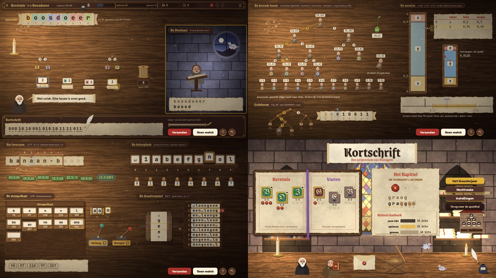

# Kortschrift: art & audio direction

> Eigenaar: art & audio director. Voor: gameplay/front-end engineer (scènes, UI, juice) en QA.
> Functionele eisen (wat moet bewegen, lettergroottes, layout, juice-lijst #1–39, audio-tabel) staan in `GDD.md`
> (§2.2, §4.3–4.4, §7). Dit document bepaalt **hoe het eruitziet en klinkt**.
>
> - Referentiescène: `res://games/scriptorium/scenes/art_preview.tscn` (code: `scripts/game/sc_art_preview.gd`).
>   Vier pagina's: 0 werkbank (binderij, HUD, De Overkant, kortschrift), 1 levende boom + codeboom + meetlat,
>   2 leesraam + letterplank + stempelkast + trommel, 3 titel + getijdenboek + Kapittel + personages. Argumenten na
>   `--`: `page=0..3`, `night=1`. Toetsen: `Tab` volgende pagina, `N` nacht. Zonder argumenten wisselt hij zelf.
> - Code die je hergebruikt (alles statisch): `ScPal` (palet, fonts, tekst, pigmentchips, ␣), `ScDraw` (materialen,
>   kaars, veer, inkt, zegels, stroken, personages, HUD), `ScDrawTools` (de werktuigen), `ScUi` (knoppen, panelen,
>   overlays) en `ScFx` (partikels). Geluid speelt de front-end af (bv. een `ScSnd` naar het voorbeeld van `TtSnd`).
> - Assets: `assets/MANIFEST.md` (bestand per gebeurtenis) · `assets/CREDITS.md` (licenties) · generators in
>   `assets/_gen/` (`sc_gen_textures.py`, `sc_gen_audio.py`).
> - Screenshots: `design/screens/` (00 = overzicht van de vier pagina's).

---

## 1. Stijl: "Kaarslicht-scriptorium", getekend in code op perkament en hout

Kortschrift is **handwerk aan een schrijftafel bij kaarslicht**: warm, stil, tastbaar. Wat het spel *is*, tekenen we in
Godot zelf (`draw_*`), zoals Trietuin en Hash & Dash: werktuigen, letters, bits, zegels en monniken zijn dynamisch en
moeten op elke grootte scherp zijn. Python genereert wat in code duur is: vier geschilderde achtergronden, drie naadloze
detailtexturen (perkament, hout, leer) die we in code over polygonen leggen, partikeltexturen en alle audio.

**Moodboard in woorden.** Een donkere notenhouten schrijftafel van bovenaf, verlicht door één kaars linksboven. Daarop
liggen vellen perkament met geschepte, verbruinde randen; de werktuigen zijn van eik, touw, koper en zegelwas. De UI is
**ossenbloed boekbandleer met goudstempeling** (dubbele goudlijn, hoekfleurons), de titels staan in een gotische hand.
Achter de tafel (titel, kaart) een natuurstenen scriptorium met een glas-in-loodraam waarin een **gouden codeboom**
zit, lichtbundels met stof, een boekenkast en een rollenkast. De ontvangende abdij (De Overkant) is **koel en
maanverlicht** (blauwgrijze steen, een oculus met de maan en een duiventil), zodat je altijd ziet aan welke kant je bent.

**Waarom anders dan de andere games.** Hash & Dash = koel nachtdepot, Trietuin = lichte tuin bij dag, TELEX = nachtelijke
retro-console. Kortschrift = **warm interieur bij kaarslicht**: donkere houttonen rond, lichte perkamentvlakken in het
midden. Familie in de hub: dezelfde Fredoka + JetBrains Mono, dezelfde drukbare knoppen en Kenney-klikjes, dezelfde
semantiek (één gloed tegelijk, nooit rood voor fout), licht van linksboven.

**Vormtaal.** Ambachtelijk en licht onregelmatig: geschepte perkamentranden (`ScDraw.deckle_pts`), was met grillige rand,
stempelafdrukken met kleine inktgaatjes, touw met knoop. Hout krijgt een lichtrand linksboven en een donkere onderrand
(dikte). Monniken zijn chibi-figuurtjes (klok-habijt, tonsuur, blosjes), knus maar niet kinderachtig. Rond = levend
(monniken, duif, zegels), recht = gereedschap (raam, kast, rek, plank, meetlat). Schaduw 5–8 px naar rechtsonder.

---

## 2. Palet (`ScPal`, gebruik altijd de tokens)

### 2.1 UI: leer en goud
| token | hex | gebruik |
|---|---|---|
| `PANEL` / `PANEL_HI` / `PANEL_LO` | `#3B2420` / `#52332C` / `#2A1916` | HUD, panelen, knoppen, verzonken pillen |
| `SLOT` / `OUTLINE` | `#1C100E` / `#170D0B` | meter-tracks, outline van floaters |
| `TEXT` / `TEXT_DIM` | `#FBF0D9` / `#CDB394` | tekst op leer |
| `GILT` / `GILT_LIGHT` / `GILT_DARK` | `#D9A93E` / `#F4D27A` / `#9C7224` | goudstempeling, titels op leer |

### 2.2 Perkament en inkt
| token | hex | gebruik |
|---|---|---|
| `VELLUM` / `VELLUM_HI` | `#F2E4C4` / `#FBF3DE` | opdrachtband, kortschrift-strook, kaartjes, tegels |
| `VELLUM_EDGE` / `VELLUM_AGED` | `#D8BF8E` / `#C9A66E` | dikte/onderrand, verbruinde rand |
| `INK` | `#2B1D14` | **alle** letters, bits en getallen op perkament of chip |
| `INK_SOFT` / `INK_FADED` | `#7A6249` / `#A68E70` | posities, nummers / al gecodeerd, gedimd |
| `SEPIA` | `#8E5A2E` | "anders gelezen" (altijd met een inktvlek, nooit enkel kleur) |

### 2.3 Pigmenten, was, hout, licht
| token | hex | | token | hex |
|---|---|---|---|---|
| `RUBRIC` (vermiljoen) | `#B8402C` | | `OAK` / `_LIGHT` / `_DARK` | `#9A6A3E` / `#C08A55` / `#5E3B22` |
| `LAPIS` / `LAPIS_LIGHT` | `#2E5AA8` / `#6FA8E8` | | `WALNUT` | `#4A2E1C` |
| `VERDIGRIS` | `#3E9A7E` | | `BRASS` / `_DARK` | `#C79A45` / `#7E5C22` |
| `FOLIUM` (paars) | `#7E4A9E` | | `IRON` / `_LIGHT` | `#4B4A50` / `#8E8C96` |
| `GOLD` / `_LIGHT` / `_DARK` | `#E2B13C` / `#F7DB86` / `#A87A1E` | | `TWINE` / `_DARK` | `#C9A66B` / `#8E6E3E` |
| `WAX` / `_LIGHT` / `_DARK` (lakzegel) | `#A8302A` / `#D25A4A` / `#6E1B18` | | `FLAME` / `_CORE` / `_OUT` | `#FFD27A` / `#FFF6D8` / `#FF9A3C` |
| `WAX_GREEN` / `_DARK` (LZ77-zegel) | `#4F7A3A` / `#2F4E22` | | `CANDLE` / `_SHADE` | `#EFE3C4` / `#CDB98E` |
| `STONE` / `_DARK` / `_LIGHT` | `#4A3B39` / `#2A2024` / `#8C7562` | | `COOL` / `COOL_LIGHT` (De Overkant) | `#33374A` / `#6A6A80` |

### 2.4 Semantiek (familie, getemperd)
| token | hex | betekenis |
|---|---|---|
| `INFO` | `#6FA8E8` (lapis) | "hier kijk je": cursor, selectie, focusring, spleet in het rek, zetstok-k als wk nieuw is |
| `GOLD` = `MATCH` = `STAR` | `#E2B13C` / `#E8B53A` | gelijk gelezen (gouden stip), optimum-geest, interval [low; up), juiste pad, sterren |
| `WARN` (amber) | `#E89B2C` | inkt boven het optimum: inktpot borrelt, meter en koker-overschot amber |
| `OK` | `#4DBF8F` | goed (spaarzaam; de wereld zegt het meestal met goud) |
| `ERR` | `#D5533F` | enkel als de Nachtwake-kaars echt op is. **Nooit** voor een fout antwoord |
| `SEPIA` + inktvlek | `#8E5A2E` | anders gelezen letter (de "fout" is een gevolg in de wereld) |
| `BRAND` | `#C77DFF` | hubkleur (HubRegistry); in het spel enkel via `FOLIUM`-linten |

**Vermiljoen (`RUBRIC`) is decoratief**: initialen, rubrieken, de rode draad van LZ77, de Stempel-hendel. Middeleeuwse
handschriften gebruiken zwart en rood; rood betekent hier nooit "fout".

### 2.5 Pigmentchips voor letters
Zoals de chips in Trietuin: een letter staat **in INK op een bleke pigmentchip**. Dezelfde kleur verschijnt op de
stapel, het blad van de boom, de monnik, de opdrachtband en het codeboek. `ScPal.letter_color(ch, alphabet)` met
`alphabet` = de letters van het level in vaste volgorde (bv. de stapelrij `boesdr`). Cyclus van 10:
`#F2C76B #9FD0C0 #E8A2A0 #A9BCEB #C9B3E0 #BFD889 #F0B07A #8FD3E0 #E3B9D6 #D9CBA3`; spatie `#E0D3B5`; > 10 letters
neutraal `#EDE1C4`. Chips zijn pastel en niet-semantisch.

### 2.6 Meetlat, hoofdstukken, personages
- Meetlatvakken: kleur **én** arcering (`ScPal.segment_color(k)`, `segment_hatch(k)`: geen, schuin, recht, stippen, kruis):
  `#E9C46A #8FC1E3 #E79A8F #A7D18B #C9A9E0`.
- Hoofdstukken (`ScPal.CHAPTERS`): lint + initiaalveld per kerkelijke tijd (Advent paars/lapis, Kerstmis vermiljoen/groen,
  Vasten paars/wijnrood, Pasen goud/lapis, Pinksteren vermiljoen, Hooimaand kopergroen/oker, Wijnmaand wijn/indigo,
  Allerheiligen goud/nacht).
- Habijten: Zeno zwart `#2F2A2C`, Letterlijk grijs `#8F887C`, Gommaar bruin `#6B5233`, processie 4 warme grijsbruinen
  (`HABITS`). Huid `#EDBE9C`, blos `#E88A7E`. Duif `#CFCAD4` met iriserende hals `#7FA897`/`#9A7FB3`. nng-zaadje
  `#7FB04F`.

---

## 3. Typografie
| rol | font | via |
|---|---|---|
| **bits, codes, letters, getallen, drietallen, posities** | JetBrains Mono ExtraBold/Bold/Medium als **MSDF** (scherp bij zoom op de meetlat en schaal-tweens) | `ScPal.MONO`, `MONO_B`, `MONO_M` |
| titels, hoofdstukken, kopjes van panelen, "Kelners kasboek" | **Grenze Gotisch** (OFL, variabel, gewicht 700/500) | `ScPal.TITLE`, `TITLE_LIGHT` |
| verluchte initialen (één hoofdletter op de kaart) | **UnifrakturMaguntia** (OFL) | `ScPal.INITIAL` |
| knoppen, HUD-labels, zinnen, Zeno-ballon | Fredoka SemiBold/Bold/Medium (gedeeld) | `ScPal.UI`, `UI_BOLD`, `UI_MED` |

- **Nooit** gotisch voor leerstof of lopende zinnen: enkel titels. Bits en codes blijven altijd JetBrains Mono.
- **Spatie = ␣** (GDD §3.0) via `ScPal.show(ch)`. Het glyph `␣` van JetBrains Mono lijkt op klein formaat op `_`, dat in
  Oef. 81/97/101 een gewoon teken is. Daarom tekent `ScPal.text_c`/`word` de spatie als een **open bakje met hoge
  pootjes** (`ScPal.space_glyph`). Gebruik dus altijd die helpers voor losse tekens.
- Bits in het kortschrift: inktcijfer met een **penstreek eronder: kort voor 0, lang voor 1** (ook zonder kleur te
  onderscheiden). Codewoorden worden gescheiden door een dun streepje.
- Groottes (GDD §4.3, bindend): opdrachtband 44 (n ≤ 30) of 32, posities 18, bits 28, lakzegel 36, wassen zegel 40,
  stempelafdruk 40, HUD 28–32, titels 40–104. **Nooit < 16 px.** `ScPal.fit_word` kiest de grootste maat die past.
- Floaters (`+10`): Fredoka Bold met outline 8 in `OUTLINE` (`ScPal.text_outline_c`), zoals in H&D.

---

## 4. Vormtaal en maatvoering
| element | functie | maat / detail |
|---|---|---|
| leren paneel (HUD, kortschrift, menu) | `ScDraw.leather(ci, rect)` / `ScUi.panel_box()` | radius 18–20, leertextuur, dubbele goudlijn 8/13 px binnen, fleurons, schaduw (0, 10) |
| perkament (band, strook, kaart, rol) | `ScDraw.parchment(ci, rect, seed)` / `ScUi.paper_box()` | geschepte rand ±2,5 px, vellumtextuur, verbruinde rand 9 px 22 % + 3 px 45 % |
| hout (raam, kast, plank, tegels) | `ScDraw.wood(ci, rect, col, rad)` | nerftextuur, lichtrand linksboven, onderrand 4–6 px in −35 % |
| knop | `ScUi.button(text, kind)` | PRIMARY bladgoud + inkt · SECONDARY leer + goudrand · WAX zegelwas (verzenden/bevestigen) · GHOST · VELLUM (in de wereld, bv. "Geen match"). Hover 3 px omhoog, druk squash (1,06; 0,92) → elastisch |
| icoonknop | `ScUi.icon_button("hint")` | rond, getekend goudstempel-icoon (`ScDraw.tool_icon`: pause, hint, undo, notes, twine, search, bump, zero, candle, ink + alle werktuigen) |
| chip / kaartje | `ScPal.sb_thick` | radius 0,2 × fontgrootte, onderrand 3–4 px |
| selectiering | `ScPal.ring` | `INFO`, 3 px, alfa pulseert met sin(6–7 t) |

**Getextureerde vlakken**: `ScDraw.prepare(node)` één keer in `_ready` (zet `texture_repeat` aan). Grote NPOT-beelden
(achtergronden, `bg_overkant.jpg`) als eigen `TextureRect`, niet in een draw-callback met repeat (gaf een grijs vlak).

---

## 5. De elementen (functie → GDD)

### 5.1 Werkbank, HUD en De Overkant (GDD §2.2, §4.3)
- **Achtergrond** `assets/art/bg/bg_desk.jpg`: notenhouten tafel van bovenaf, kaarslicht linksboven, raamlicht rechtsboven,
  inktvlekken en krassen enkel aan de randen (het midden blijft rustig). Nachtwake: `bg_desk_night.jpg` (kaars linksonder,
  maanlicht). Leg er `ScUi.candle_overlay(light_pos)` over (flakkerend vignet; zet `light_pos` op de getekende kaars).
- **HUD-balk** (y 0–72): `leather`, titel in `TITLE` 32 ("Kerstmis · 1-1 Boosdoeer"), notasverwijzing `UI_MED` 18,
  **inktmeter** `ScDraw.ink_meter(ci, rect, ink, opt, plain)` (inktpotje, druppelteller, balk met geesten *gewoon* en
  *optimum* in goud; boven het optimum wordt alles amber en borrelt de pot), pillen `ScDraw.pill(..., "twine"|"search"|
  "bump"|"zero", tekst)`, sterren als `ScDraw.star_seal`.
- **Opdrachtband** `ScDraw.task_band(ci, left_mid, text, cell 58, size 44, cursor, done_before, show_idx, alphabet, chips)`
  → centra. Perkamentband met zwaluwstaarten, posities eronder; al gecodeerd = gedimd + gouden streepje; cursor =
  lapisring + driehoekje. In ontvangstlevels dezelfde band voor de kopie.
- **Kortschrift** `ScDraw.shorthand(ci, left_mid, tokens, 28, koker_px)` met tokens `{"b": "010"}`, `{"raw": "g"}`
  (lakzegel), `{"triple": [p,l,x]}` (groen wassen zegel), `{"code": 257}` (stempelafdruk), `{"num": 7}`. Gouden lijn =
  einde van de koker; bits erachter worden amber. **Koker** `ScDraw.koker(ci, left_mid, length, fill)`: leer + koper;
  `fill > 1` laat de strook uitsteken en krullen. **Ganzenveer** `ScDraw.quill(ci, tip, s, ang, t, writing)` aan de
  cursor.
- **De Overkant** (x 1280–1920): `bg_overkant.jpg` (koele nis, oculus met maan en duiventil), goudlijst, kopje
  "De Overkant · <huis>". **Broeder Letterlijk** `ScDraw.letterlijk(ci, c, s, t, mood, talk)` achter zijn lessenaar
  (mood 0 leest, 1 zingt/blij, 2 fronst, 3 schraapt zijn keel "hm-hm"). Zijn kopie: `ScDraw.reading(ci, left_mid, orig,
  read, size, shown, t, pulse)`: origineel boven (INK_SOFT), gelezen eronder; gelijk = INK + **gouden stip**, anders =
  SEPIA + **inktvlek** + streepje (vorm én kleur). Miniatuur-structuren: dezelfde ScDrawTools-functies op schaal 0,5.
- **Zeno** `ScDraw.zeno(ci, c, s, t, talk)` (zwart habijt, witte baard, brilletje) met `ScDraw.scroll(ci, rect, tail)`
  (perkamentrol met opgekrulde uiteinden), ≤ 12 woorden, `UI` 24 in INK. **Inkthand** `ScDraw.inkhand(ci, tip, s, t, a,
  press)`: doorschijnend bladgoud, wijst en "drukt".

### 5.2 Codeboom, codebord, binderij (GDD §3.1–3.3)
- **Tak** `ScDrawTools.branch(ci, a, b, bit, hi, w)`: eiken staaf met een bitschijfje halverwege (0 links, 1 rechts);
  `hi` = gouden pad (leesvinger, juiste pad); `ghost` = gestippeld goud (spookhand, codebord-leeg).
- **Knoop** `knob(ci, c, r, hi, label)`; **blad** `leaf_tile(ci, top, ch, size, alphabet, hi, code, t, weight, dim)`:
  lettertegel aan een touwtje (wiegt), codewoord eronder in `MONO_B` 18 → klikzone. Codebord: lege knopen = `knob`
  + gestippelde `branch(ghost)`.
- **Stapel** `pile(ci, base, label, w, alphabet, selected, t, bundle, width, hint)`: strookjes perkament, hoogte ∝ gewicht
  (11 px per strook, > 10 samengedrukt), kaartje met pigmentchip + gewicht; `selected` tilt 14 px op + lapisring;
  `bundle` = touw + knoop; `hint` = gouden ring (inkthand). Gebonden bundels krijgen hun boompje erboven (`branch` +
  `knob` + `leaf_tile` 26 px), zoals de figuur op p. 85.
- **Touwklos** `twine_spool(ci, c, s, t, twine, amber, spin)` met teller en "touw = bits" (Stelling 21).
- **Codeboek** (ontrollen): `ScDrawTools.ledger_table(ci, rect, ["letter","code","a(x)","l·a"], rows)` + shader
  `sc_ink_reveal` voor het inkt-in-vloeien.
- **Twee planken** (1-5): dezelfde `pile`s op twee `wood`-planken; voorkant links, zoekwerk-pil `search`.

### 5.3 Levende boom en processie (GDD §3.4)
- **Monnik** `ScDraw.monk(ci, feet, s, t, habit, card, hi, lantern, stumble, facing, mood, walk, sym, alphabet)` → rect
  van het kaartje. Interne top = monnik met kaartje `[g,o]` boven het hoofd; blad = monnik met de **letter als
  pigmentchip op de borst**; `lantern` = de lantaarn (t van Algoritme 11) hangt boven hem; `hi` = lapisring onder zijn
  voeten (t′-kandidaat / hover); `stumble` 0..1 = scheef + verbaasd (eigenschap (b) gebroken, GDD #18); `walk` 0..1 =
  loopcyclus voor de wissel (boog, 0,5 s).
- **Processie**: dezelfde monniken op s = 0,8 op een eiken lat, kaartje `g·o`, broers 2j−1/2j hand in hand
  (`ScDrawTools.hand_link`). **nng-zaadje** `seed_nng(ci, c, s, t, "[0,1]", hi, sprout)`: groen zaadje met kiempje
  (`sprout` laat het kiemen bij GROEI). **Lantaarn** `ScDraw.lantern_` met eigen gloed.
- **Lakzegel** (ruwe letter, 8 bits) `ScDraw.seal(ci, c, r, letter, MONO, size, WAX)`.

### 5.4 Meetlat en binaire naald (GDD §3.5)
- `ScDrawTools.ruler(ci, rect, segs, hi_sym, pin, t, labels, hatch)` → {sym: Rect2}. Eiken lijst, vakken onder→boven in
  modelvolgorde met kleur + arcering, letterchip in het vak, **onderrand = volle inktlijn (dicht), bovenrand = stippellijn
  (open)**, grenswaarden links in `MONO_M` 20. `pin` = koperen speld met rode lijn (ontvangen). Zoom: tween `segs` naar
  het nieuwe interval (0,6 s `TRANS_QUART` in-out), schaar `ScDrawTools.scissors(ci, c, s, open, rot)`.
- **Rekenboek** `ledger_table` (i · teken · links · lengte; laatste regel goud).
- **Naald** `needle(ci, rect, view0, view1, low, up, getal, next, t, labels, overshoot)`: perkamenten getallenlijn,
  goud = [low; up) met volle onderrand en gestippelde bovenrand, ijzeren naald op `getal`, lapis spookstreep "+next";
  in het goud: gloed; `overshoot` laat de naald trillen.

### 5.5 Leesraam (GDD §3.6)
- `reading_window(ci, left_mid, text, ws, G, cell 52, size 40, hi_p, show_pos, t, upto)` → centra. Perkamenten regel, eiken
  raam (vier latten + koperen nagels) over [ws, ws+G), posities boven het raam (tutorial/hulplijnen), nog niet
  geschreven tekst gedimd. **Rode draad** `thread(ci, a, b, prog, t, lift)`: boog van bron naar doel met naald,
  `prog` 0..1 loopt letter per letter (60 ms/letter, GDD #25). **Wassen zegel** `ScDraw.triple_seal(ci, c, p, l, x, size,
  hi)`: groene was, `(p,l,x)` in `MONO_B` (EOF voluit). Register (4-6): `branch`/`knob` met lantaarn.

### 5.6 Stempelkast (GDD §3.7)
- `cabinet(ci, rect, base, news, open_code, empty_code, fresh_code, t, cols)` → {code: Rect2}: notenhouten kast, basisladen
  (letter + ASCII), goudlijn, nieuwe laden 256… (woord + nummer; `²` = dubbele lade bij EARLY_STAMP). `drawer(...)`:
  `open` schuift uit, **`empty` = donker binnenwerk met stofjes** (speciaal geval), `fresh` = net gesneden (goudring).
- **Zetstok** `zetstok(ci, left_mid, w, k, in_case, size, t)`: koperen houder met loden lettertjes w; k zweeft ernaast,
  **goud als wk al in de kast zit, lapis als niet**. **Hendels** `lever(ci, base, "Verleng", "V", pulled, hi, VERDIGRIS)`
  en `lever(..., "Stempel", "S", ..., RUBRIC)`. **Stempelafdruk** `ScDraw.stamp_print(ci, c, "257", 28)`.

### 5.7 Draaitrommel, rek, letterplank (GDD §3.8–3.9)
- `drum(ci, c, rw, rh, text, spin, t, size)`: eiken trommel met ijzeren banden en slinger; perkamentband met de tekst,
  letters krimpen naar boven/onder (perspectief), goudring = de rotatie vooraan. `spin` tweenen per slag (0,3 s).
- `rack(ci, pos, rows, size, marked, gap, pending, pending_at, t, row_nums, hi_row)` → rij-rects: stroken op een
  notenhouten rek, **eerste kolom lapis-getint, laatste kolom goud** (de uitvoer), rijnummers 0…n−1, `gap` = lapis
  spleet (invoegen), `marked` = goudring + lakzegel "p", `pending` = zwevende strook met schaduw.
- Terugweg (ontvangen): twee `rack`s van één kolom (e en c) met `ScDrawTools.thread` als pijl c[i] → e[i].
- **Letterplank** `shelf(ci, left_mid, items, block 60, show_pos, hi, t)` → zones; **cijferstempels**
  `digit_stamp(ci, c, d, s, hi, pressed)`.

### 5.8 Duiventil, kaart, brief, kist, Kapittel
- **Duiventil** `dovecote(ci, c, s, filled, t)` → {label: Rect2}: zeven hokken ε, 0, 1, 00, 01, 10, 11 met labels, zolder
  met 16 lange hokken (4 bits).
- **Titel**: `bg_room.jpg` + `ScUi.shafts_overlay()`; "Kortschrift" in `TITLE` 104 INK op `ScDraw.scroll`, ondertitel
  `TITLE_LIGHT` 30 in RUBRIC; menuknoppen rechts (PRIMARY "Het kloosterjaar").
- **Getijdenboek** `book_spread(ci, rect, ribbon_col, t)` → [linkerblad, rechterblad]; hoofdstuktitel `TITLE` 40 in de
  hoofdstukkleur; levels als **verluchte initialen** `initial(ci, rect 86², letter, chapter, stars, locked, hi, t, tool,
  "1-2")`: goud/pigmentveld, fraktuur-hoofdletter, rankwerk, werktuigicoon, 0–3 lakzegels; dicht = steengrijs + slotje.
- **Brief** `letter(ci, c, s, open, seal_col, mono)`; **kist** `crate(ci, c, s, open, t)` + `ScFx.crate_open`.
- **Kapittel**: `parchment` + `TITLE` "Het Kapittel", kopregel `UI_BOLD` ("VERLIESLOOS" in GOLD_DARK of "DE OVERKANT LAS
  ONZIN" in SEPIA), sterren `star_seal(ci, c, r, filled, press)` (tween `press` 0 → 1 met overshoot, gestaggerd 0,25 s),
  `reading(...)` met klikbare inktvlekken, **Kelners kasboek** `ledger_bars(ci, rect, rows, "bits")` (jouw inkt INK,
  optimum GOLD, gewoon INK_FADED; Huffman/vaste lengte INK_SOFT). Gommaar `ScDraw.gommaar` erbij.
- **Notas-weergave**: zoals Trietuin: kaal perkament (`ScUi.paper_box`), INK-lijnen 2 px, `MONO` 22, geen chips of
  schaduw; enkel de fout (SEPIA) en de juiste zet (GOLD) krijgen kleur.
- **Nachtwake**: `bg_desk_night`, drie kaarsen op een kandelaar `ScDraw.candle(ci, base, s, t, lit, burn, flare)`
  (`burn` 1 → 0 = de rondetijd, `flare` = Volle vlam), `candle_overlay` met `darkness` 0,6.

---

## 6. Animatie en juice

### 6.1 Timing (Godot-tweens; GDD §7.1 noemt de momenten)
| soort | trans / ease | duur |
|---|---|---|
| verschijnen (UI, zegel, kaartje) | `TRANS_BACK` / out | 0,18–0,25 s (`ScUi.pop_in`) |
| verdwijnen | `TRANS_QUAD` / in | 0,12–0,15 s |
| binden (stapels naar elkaar, touw wikkelt) | `TRANS_BACK` 0,25 s, dan touw 0,3 s, knoop pop 0,1 s | |
| wissel (monniken in een boog) | `TRANS_CUBIC` in-out | 0,5 s; `walk` 0 → 2 |
| zegel/stempel drukken | squash (1,0 → 0,85 → 1,0) | 0,15–0,2 s, schermschok ≤ 3 px |
| meetlat-zoom | `TRANS_QUART` in-out | 0,6 s |
| raam schuift, rek-spleet | `TRANS_CUBIC` out | 0,2 / 0,12 s |
| kopiist schrijft bits | 40 ms/bit (snel 15 ms) | veer `writing` = 1 |
| voorlezing | 0,18 s per letter | stip/vlek pop-in |
| idle | `sin()` in `_process` | kaars flakkert (13/23 Hz), bladeren/tegels wiegen ±2 px, monniken ademen, duif knikt |

Regels: één gloed tegelijk (INFO = hier kijken, GOLD = goed/doel, WARN = let op). Feedback binnen één frame (geluid +
tik). Gestaggerde reeksen 30–80 ms. Nooit lineaire tweens voor zichtbare objecten. Schok via `Juice.shake` (max 3 px:
een scriptorium schudt weinig). Slow-mo enkel wereld.

### 6.2 Partikels (`ScFx`, texturen in `assets/art/particles/`)
| moment (GDD #) | recept |
|---|---|
| sfeer (altijd, laag) | `ambient_dust` (additieve stofjes in het kaarslicht) |
| bit/letter geschreven (#1, #2) | `ink_flick` (3 spatjes) |
| anders gelezen (#11, #13) | `ink_splash` (spetters + vlek) + `ScDraw.ink_blot` op de letter |
| lakzegel / ster (#3, #26, #36) | `wax_splat(fx, pos, WAX)` (LZ77: `WAX_GREEN`) |
| binden (#7) | `twine_knot` |
| knippen (#5, #20) | `snip` (perkamentsnippers) |
| stempel snijden / klem (#6, #29) | `shavings` / `dust_puff` (grijsbruin, nooit rood) |
| lege lade (#30) | `dust_puff` |
| kist (#37) | `crate_open` (stro + bladgoud) |
| voorlezing juist (#12) | `gold_rain` + `ring_wave(GOLD)` |
| duif (#10) | `feathers` |
| Volle vlam (#39) | `embers` + `candle(flare = 1)` |
| lichtbronnen | `glow_sprite` (additief) |

### 6.3 Shaders (`assets/art/shaders/`)
- `sc_candlelight.gdshader`: vignet + flakkerende warme poel (`ScUi.candle_overlay(light_pos, darkness, radius)`).
- `sc_light_shafts.gdshader`: lichtbundels + stofjes van het glas-in-loodraam, additief (`ScUi.shafts_overlay`).
- `sc_ink_reveal.gdshader`: `progress` 0 → 1 laat inkt van links naar rechts in het perkament vloeien met een natte rand
  (codeboek, brief, Kapittel-kopregel).

---

## 7. Leesbaarheid en toegankelijkheid (checklist)
1. Leerstof altijd **INK op perkament of pigmentchip** (contrast ≥ 7:1) in JetBrains Mono; tekst op leer in `TEXT`.
2. Spatie = getekend bakje ␣ (≠ `_`). `0` met punt is nooit `O`.
3. **Kleurenblind**: gelijk/anders = gouden stip vs. inktvlek + streepje; bits 0/1 = korte/lange penstreek; meetlat =
   arcering + letter; zetstok-k = goud vs. lapis + ring; dicht/open rand = volle lijn vs. stippels; sterren = gevuld
   zegel vs. gestippelde lege plek; amber = ook een uitstekende, krullende strook.
4. Nergens < 16 px. Woorden op de werkbank 28–44 px.
5. Achtergronden houden het midden rustig (vlekken en krassen enkel aan de randen; De Overkant is koel en donker zodat
   Letterlijk en zijn kopie oplichten).
6. Partikels nooit vóór labels (z: sfeer < werktuigen < labels < UI).
7. Gotische fonts enkel voor titels; de initialen op de kaart dragen ook het levelnummer in mono eronder.

---

## 8. Audio direction

**Klankkleur.** Akoestisch en ambachtelijk in een stenen ruimte: ganzenveer op perkament, hout, touw, was, koper, papier,
duiven, kloosterklok en een synthetisch mannenkoor. Alles met een korte kloostergang-galm. **Fouten klinken niet als
straf**: een houten tok met veertje (klem), een holle lade, een dissonant koortje en een vallende kan (onzin-voorlezing).
UI-klikken blijven de gedeelde Kenney-klikjes (`Sfx.ui`), plus een eigen `ui_wood` en `ui_whoosh`. Bussen: `Music`, `SFX`,
`UI` (autoload `Sfx`). `Sfx.play_track` kent enkel H&D: speel Kortschrift-bestanden af met eigen spelers (zoals `TtSnd`).

**Mix.** Muziek basis −8 à −10 dB, denklaag (`sc_bench_pad_loop`) synchroon erbij na 8 s nadenken (fade 2 s), weg tijdens de
voorlezing (−∞ in 0,6 s). Sfeer (`amb_scriptorium_loop`) −16 dB. SFX 0 dB, UI −6 dB. Herhaalde geluiden: `pitch_scale`
random 0,94–1,06, max 4 tegelijk. **Letterzang** (voorlezing): `sing_a/o/e` (A3) getransponeerd per letter,
`pitch_scale = pow(2, [0,2,3,5,7,9,10,12][hash(ch) % 8] / 12)` (D-dorisch), klinker volgens de letter (a/o/e-groep).
**Gewicht +1**: `weight_bell` met `pitch_scale` 1, 1,12, 1,26 … per niveau. **Draad**: `thread_pluck` stijgend per
letter (pentatonisch). Bit schrijven: `quill_0` / `quill_1` naar het bit.

**Muziek** (procedureel, D-dorisch, naadloze lussen; `.import` staat op loop):
| bestand | tempo | inhoud |
|---|---|---|
| `sc_title_loop` (titel, kaart) | 66 BPM, 58 s | kistorgel + koor (a/o), koraal |
| `sc_bench_loop` (werkbank) | 72 BPM, 53 s | luit-arpeggio's (Karplus-Strong) + bourdon |
| `sc_bench_pad_loop` (denklaag) | idem, synchroon | koorpad op de akkoorden |
| `sc_wake_loop` (Nachtwake) | 88 BPM, 44 s | snellere luit, waterklok-tik, bourdon |
| `sc_wake_heart_loop` | idem, synchroon | hartslagtrom (bij weinig kaars) |
| `sc_codex_loop` (Allerheiligen) | 66 BPM, 58 s | koraal + luit + volle koorbezetting |
| `sc_jingle_1/2/3` | – | terugblik naar sterren (3 = met klok) |

Elk geluid per gebeurtenis: zie `assets/MANIFEST.md`.

---

## 9. Do / Don't
- **Do**: leerstof in mono, INK op perkament of chip. Eén gloed tegelijk. Gevolgen in de wereld (inktvlek, amber koker,
  struikelende monnik, lege lade) in plaats van rood. Licht van linksboven. Alles via ScPal/ScDraw/ScDrawTools.
- **Don't**: gotisch voor zinnen of bits. Rood voor fouten. Tekst < 16 px. Default Godot-thema of grijze panelen. Tweens
  zonder easing. Emoji. Partikels over labels. Drukte in het midden van de werkbank.

## 10. Eerlijke status
Sterk: eigen identiteit (kaarslicht, leer en goud, perkament, was, glas-in-lood) die toch familie is; leesbaarheid van
bits/codes/letters (MSDF-mono, pigmentchips, getekende ␣); elk werktuig van de GDD heeft een getekende vorm met klikzones;
volledige SFX-set per gebeurtenis en zes muzieklussen.
Te bewaken door de front-end:
- de preview plaatst alles met de hand; echte bomen hebben `ScTreeLayout` nodig (min. 110 px tussen bladeren, kaartjes
  ≥ 16 px). Monniken op s = 1,0 in de boom, 0,8 in de processie;
- de animaties zelf (de preview toont idle, partikels, de draad, de hendel en de naald); timings in §6;
- `bg_desk_night` + `candle_overlay` is nog vrij licht: verhoog `darkness` naar 0,7 als de Nachtwake te weinig "nacht" is;
- muziek en koor zijn procedureel en niet door een mens beluisterd: laat QA de lussen een paar minuten horen; is het koor
  te nasaal, verlaag dan de denklaag.
