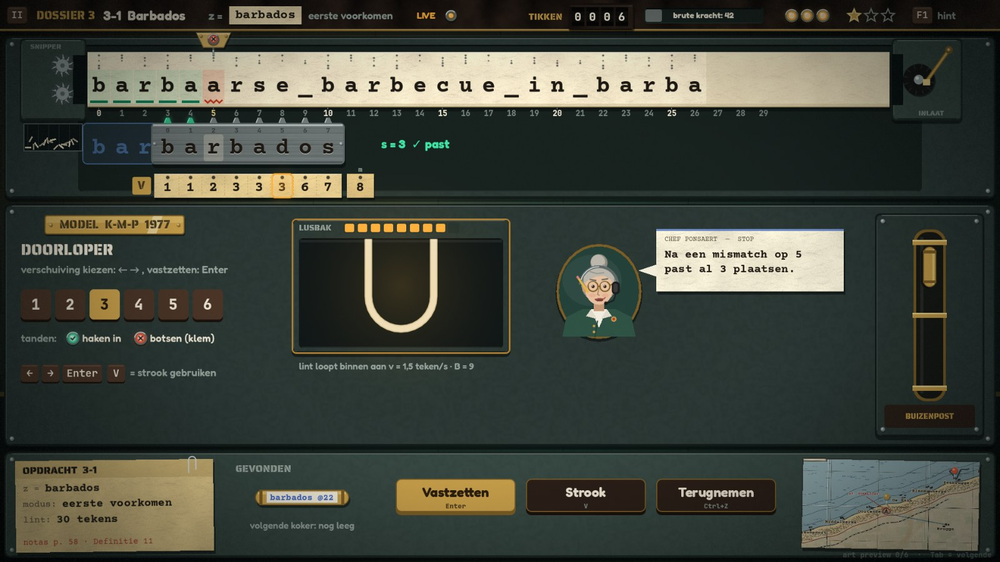

# TELEX: art & audio direction

> Eigenaar: art & audio director. Lezers: gameplay/front-end-engineer (scènes, UI, juice), core (enkel §8 audio-namen) en QA.
> De functionele eisen (wat leesbaar moet zijn, wat beweegt, lettergroottes, HUD-layout, juice #1–38, audiotabel)
> staan in `GDD.md` §2.2, §4, §7. Dit document legt vast **hoe het eruitziet en klinkt**.
>
> - Referentiescène: `res://games/telex/scenes/art_preview.tscn` (code: `scripts/game/tx_art_preview.gd`). Zeven
>   pagina's, argument na `--`: `page=0..6`. Toetsen: Tab/→ volgende, ← vorige, 0–6 direct. Zonder argument wisselt
>   de scène elke 6 s.
> - Herbruikbare code (alles statisch, je hoeft niets te instantiëren):
>   `TxPal` (`tx_pal.gd`: palet, fonts, maten, ITA2-tabel, panelen, lampen, plaatjes, knoppen, thema),
>   `TxDraw` (`tx_draw.gd`: lint, leeskop, sjabloon, strook, versnipperaar, inlaat, lusbak, HUD, buizenpost, kaart,
>   personages, mappen, kist, iconen, logo, UI-onderdelen) en
>   `TxDrawMachines` (`tx_draw_machines.gd`: hashwiel, hendels, bitvenster, alarm, kaartenbak, ponsbank, lampenbord,
>   ponskaarten, matrixlog, ruisbord, kabel, schakelbord/zoeklicht, herstelstrook, schijnwerper).
> - Assets: `assets/MANIFEST.md` (welk bestand bij welk event) · `assets/CREDITS.md` (licenties) · generators in
>   `assets/_gen/`.
> - Screenshots: `design/screens/01..07_*.jpg` (één per preview-pagina).

---

## 1. Stijl: "Nachtdienst in Station Zoeklicht"

**Een analoge operator-thriller, België 1961, met machines uit de toekomst.** Je zit 's nachts aan een zware
groengrijze console in een bunker in de duinen. Boven je ratelt een crèmekleurig telexlint met ponsgaten binnen.
Onder het lint liggen gereedschappen van messing, staal en bakeliet: een sjabloon met tanden, een hashwiel, een
kaartenbak, een lampenbord. Alles gloeit zacht: groene en amberkleurige controlelampjes, een warme bureaulamp
linksboven, en het koele schijnsel van de lampen op het paneel.

**Moodboard in woorden.** Papers, Please (getypte formulieren, stempels) ontmoet Keep Talking (tastbare panelen) in
het interieur van een Belgisch PTT-centrum. Hamerslaglak in flessengroen. Messing typeplaatjes met klinknagels.
Rubberen drukrollen, gevlekt bruin bakeliet, gebruikte manilla-mappen, rode draad op kurk. Typemachine-inkt op
papier, rubberstempels in rood en blauw. Het gevoel: *precies, zwaar, mechanisch, een beetje spannend*. Niets is
"digitaal": een bevestiging is een klik, een lamp of een stempel, nooit een vinkje dat oppopt.

**Waarom getekend in code (zoals Hash & Dash en Trietuin).** Wat het spel *is* (lint, sjabloon, lampen, relais,
wiel) is dynamisch en moet tot op de pixel scherp blijven. Een lintteken is een echte fontglyph, een lamp een
`draw_circle` met gloed. Python genereert enkel wat in code duur is: achtergronden, de kustkaart, papier-, lak-,
staal- en bakelietstructuren, grungy stempels, partikels en alle audio.

**Familie met de hub.** Zelfde fonts voor UI (Fredoka) en cijfers (JetBrains Mono), zelfde "drukbare" knoppen met
dikke onderrand, zelfde licht van linksboven, zelfde partikel-aanpak. **Anders dan de broers:** H&D is een koel,
rond, speelgoedachtig nachtdepot; Trietuin een lichte tuin bij dag. TELEX is **donker, hoekig-met-kleine-radius,
materiaalgedreven** (messing, staal, bakeliet, papier) en krijgt twee eigen fonts: een typemachine voor alles wat
op papier staat, een stencil voor alles wat op metaal geslagen is.

**Vormentaal.**
- *Machines*: rechthoeken met kleine radius (6–12 px), schuine rand (licht boven/links, donker onder/rechts),
  klinknagels in de hoeken, verzonken sleuven (`TxPal.well`). Ronde vormen enkel waar ze functioneel zijn: lampen,
  knoppen, wielen, rollen.
- *Papier*: scherpe hoeken, lichte rotatie (±0,01–0,04 rad) voor kaartjes en mappen, slagschaduw 3–8 px. Het lint zelf
  ligt altijd recht (leesbaarheid).
- *Signalen*: altijd lamp + vorm (zie §9), nooit enkel kleur.

**Licht.** Hoofdlicht linksboven (bureaulamp, warm). Slagschaduwen vallen 2–8 px naar rechtsonder
(`TxPal.SHADOW`, alfa 0,5). Gloed komt enkel van lampen, de naald, het zoeklicht en de leeskop (`TxPal.glow`, zacht
radiaal sprite, geen additive nodig op donker). Een schermoverlay (`assets/art/shaders/tx_overlay.gdshader`) geeft
vignet, filmkorrel en een heel trage lichtflikkering.

---

## 2. Palet

Alle waarden staan als `const` in `TxPal`. Gebruik de tokens, tik nooit zelf hex in.

### 2.1 Wereld en materialen (ver → dichtbij)
| token | hex | gebruik |
|---|---|---|
| `NIGHT` | `#0B1112` | diepste laag, gaten in lint/kaarten, sleufbodem |
| `BUNKER` | `#131C1B` | muur (zie `bg/bunker_wall.jpg`) |
| `CONSOLE_LO` | `#18221F` | verzonken vlakken, roosterachtergrond, lintgoot |
| `CONSOLE` | `#22302C` | hamerslaglak: hoofdpanelen |
| `CONSOLE_HI` | `#2F403A` | opstaande delen, behuizingen (versnipperaar, inlaat), randcellen |
| `CONSOLE_EDGE` | `#0A0F0E` | contour, voegen |
| `BAKELITE_LO / BAKELITE / BAKELITE_HI` | `#1A120D` `#2B1F18` `#4A3527` | knoppen, tikteller, relais, HUD-balk |
| `BRASS_LO / BRASS / BRASS_HI` | `#7D5E26` `#C9A04B` `#F0D68C` | leeskop, typeplaatjes, wiel, wijzers, randen, primaire knop |
| `STEEL_LO / STEEL / STEEL_HI` | `#5E6A69` `#9AA6A4` `#DCE4E1` | sjabloon, naald, tanden, schakelaars |
| `WOOD_LO / WOOD / WOOD_HI` | `#43291A` `#6B4426` `#8E5F37` | kaartenbak, kist |
| `RUBBER` | `#141414` | drukrol, kabelmantel |

### 2.2 Papier en inkt
| token | hex | gebruik |
|---|---|---|
| `PAPER` / `PAPER_HI` / `PAPER_SHADE` / `PAPER_EDGE` | `#EFE3C4` `#FBF4E1` `#D6C59C` `#B8A578` | telexlint, matrixlog, herstelstrook |
| `MANILA` / `MANILA_LO` | `#E2C98E` `#C4A866` | ponsstrook, ponskaarten, dossiermappen, opdrachtkaart |
| `CARD` | `#F4EEDC` | kaartjes van de kaartenbak, Chef-ballon, tooltips, levelkaartjes |
| `INK` / `INK_SOFT` | `#201A14` `#5C5140` | typemachine-inkt / bijschriften op papier |
| `STAMP_RED` / `STAMP_BLUE` | `#C23B2E` `#3E66C4` | stempels, V_H-waarden, notasverwijzing / gemeld voorkomen, koker-etiket |
| `TxDraw.EQ_INK` / `NE_INK` | `#13875C` `#C8361A` | gelijk/verschil-markering **op papier** (donkere varianten van de lampkleuren) |

### 2.3 Signalen (lampen)
| token | hex | betekenis | vorm (altijd mee) |
|---|---|---|---|
| `SIG_EQ` (+ `_DIM`) | `#3FE6A6` | gelijk, treffer, stroom OK, M⁰ | ✓ in de lamp · rechte onderstreep op het lint |
| `SIG_NE` (+ `_DIM`) | `#FF5A36` | verschil, mismatch, gemist, alarm | ✕ in de lamp · zigzag-onderstreep |
| `SIG_AMBER` (+ `_DIM`) | `#FFB23E` | waarschuwing, lusbak bijna vol, actief pad, cursor-hint, M¹ | knipperen (3 Hz) of rand |
| `SIG_BLUE` | `#6FA8FF` | spookhand / hint / cursor, spookkopie van het sjabloon | contour |
| `SIG_WHITE` | `#FFF4D6` | leeskop gloeit ("gaat niet terug"), voedingslamp, licht door ponsgaten | — |
| `SIG_GREY` | `#8C948F` | vals alarm (grijze speld, grijze band), klem | — |
| `HEAT` | `#FF8A3D` | warme cel (WRONG_MIN) | gloed + zoem |
| `LEVEL_COLORS` | `#3FE6A6` `#FFB23E` `#FF7AC8` | kolommen M⁰, M¹, M² van het ruisbord | label M^l erboven |
| `LAMP_GLASS` | `#24322D` | lamp uit | — |

### 2.4 UI-tekst
`TEXT #EDE5D3` (warm wit op donker), `TEXT_DIM #96A39C`, `TEXT_ON_BRASS #2A1E0E`.

### 2.5 Contrast (WCAG, nagerekend)
| paar | ratio | | paar | ratio |
|---|---|---|---|---|
| INK op PAPER | 13,5 | | TEXT op CONSOLE | 11,0 |
| INK op MANILA | 10,6 | | TEXT_DIM op CONSOLE | 5,2 |
| TEXT_ON_BRASS op BRASS | 6,7 | | TEXT op BAKELITE | 12,8 |
| STAMP_BLUE / STAMP_RED op CARD | 4,6 | | SIG_EQ / SIG_AMBER / SIG_NE op CONSOLE | 8,6 / 7,7 / 4,4 |
| EQ_INK / NE_INK op PAPER (markeringen, geen tekst) | 3,5 / 4,1 | | PAPER_HI op BAKELITE (meters) | 14,6 |

Regel: tekst staat altijd op een vlak met ≥ 4,5:1; gekleurde markeringen (onderstrepen, banden) ≥ 3:1. Lampkleur
wordt nooit als tekstkleur op papier gebruikt (daarvoor bestaan `EQ_INK`/`NE_INK`).

---

## 3. Typografie, texturen, shaders

### 3.1 Fonts
| rol | font | waar | maten |
|---|---|---|---|
| **alles wat op papier getypt staat**: lint t, sjabloon z, ponsstrook, matrixlog, herstelstrook, kaartjes, dossierkaart, Chef-ballon, coachzinnen | **Courier Prime Bold** (`TxPal.TAPE`), Regular voor bijschriften (`TAPE_REG`) | `games/telex/assets/fonts/` (OFL) | lint 44 (≤ 40 tekens) / 32; sjabloon idem; strook 28; ballon 22; kaartjes 17–26 |
| **alles wat op metaal of hout geslagen is**: typeplaatjes, paneeltitels, labels, stempels, titel-ondertitel | **Saira Stencil One** (`TxPal.STENCIL`) | idem (OFL) | 13–34 |
| cijfers die "mechanisch" zijn: rolcijfers, meters, indices, posities, wiel | **JetBrains Mono ExtraBold/Bold** (`MONO`, `MONO_B`) | `res://assets/fonts/` (gedeeld) | posities 15, indices 13, rolcijfers 0,62 × trommelhoogte |
| UI: knoppen, HUD-titels, uitleg | **Fredoka Bold/SemiBold** (`UI_BOLD`, `UI`) | `res://assets/fonts/` (gedeeld) | ≥ 16, knoppen 24–32 |

- Courier Prime is monospace: elk teken krijgt dezelfde kolom, ook `_` en `'`. Het lint en het sjabloon delen
  **exact hetzelfde raster** (`TxPal.TAPE_CELL` = 44 px, of `TAPE_CELL_SMALL` = 34 px bij lange linten).
- Fredoka mist superscriptcijfers (⁰ valt terug op een gradenteken). Schrijf M⁰/M¹ met
  `TxDrawMachines.sup_label(...)` of in UI-tekst als "M0"/"M1"; `matrix_log(..., "M^1")` doet het zelf.
- Schaal tekst nooit via `draw_set_transform`/`scale` (wordt wazig): teken op de echte grootte. Enkel stempels
  (textures) en korte squash-animaties (< 0,2 s) mogen schalen.

### 3.2 Texturen (`assets/art/`)
| bestand | gebruik |
|---|---|
| `bg/bunker_wall.jpg` 1920×1080 | achtergrond console, titel, debrief: geschilderde betonblokken, messing rail, warme lichtpoel linksboven |
| `bg/corkboard.jpg` 1920×1080 | missiekaart: kurk in houten lijst |
| `bg/coast_map.jpg` 1200×760 (+ `coast_map_points.txt`) | kustkaart 1961 (De Panne → Knokke, Station Zoeklicht in de duinen bij De Haan). Pixelcoördinaten van steden staan in het txt-bestand voor spelden, koeriers en de ploeg |
| `tex/paper_tile.png` | papiervezels (tileable, grijs): getint met `Color(1.15, 1.09, 0.95)` geeft PAPER |
| `tex/hammertone.png` | hamerslaglak, over panelen met alfa 0,07 |
| `tex/brushed.png` | geborsteld staal (sjabloon) |
| `tex/bakelite.png` | gevlekt bakeliet (HUD-balk, tikteller) |
| `tex/grain.png` | filmkorrel voor de overlay-shader |
| `stamps/*.png` (wit + alfa, grungy) | `missie_geslaagd`, `codewoord_ontsnapt`, `vals_alarm`, `geheim`, `treffer`, `ster`, `volle_stroom`, `gezien`. Tinten met `TxDraw.stamp(ci, naam, pos, kleur, schaal, rot, alfa)` |
| `particles/*.png` (wit) | `snipper` (versnipperaar, scheur), `punch_dot` (ponsconfetti), `spark` (klem, kabel), `glow`, `soft`, `dust`, `smoke` (verbrand vakje), `straw` + `splinter` (kist), `ink_splat` (sterren), `beam` (zoeklicht), `ring` (schokgolf) |

### 3.3 Shaders (`assets/art/shaders/`)
- `tx_overlay.gdshader`: ColorRect over het hele scherm in een CanvasLayer **boven de wereld en onder de UI**
  (`mouse_filter = IGNORE`). Parameters `vignette` (0,55), `grain` (0,045), `flicker` (0,015). Zet `flicker = 0` en
  `grain` halveren als de speler schermschok op 0 % zet.
- `tx_sheen.gdshader`: glansstreep over messing (`progress` 0→1 in 0,6 s): typeplaatje in de kist (juice #37),
  sterren in de debrief. In code-tekening kan het ook met `TxPal.brass_plate(..., sheen)`.

---

## 4. Layout

### 4.1 Console (1920×1080, verfijning van GDD §4.3)
| y | zone | element |
|---|---|---|
| 0–60 | HUD-balk (bakeliet, messing bies) | pauzetoets · DOSSIER (stencil, messing) · levelnaam (Fredoka) · z-chip (getypt strookje) · modus · LIVE-lamp · tikteller (rolcijfers) + geest-balk · 3 vertrouwenslampjes · sterren · F1-hint |
| 64–100 | leeskop | messing kop + lampje, naald zakt tot in het lint |
| 100–206 | **lint** (`TxPal.Y_TAPE`, hoogte 106) | x 168 … (36 kolommen à 44 px); links de versnipperaar (128 px), rechts de inlaat (136 px) |
| 208–230 | posities | JetBrains 15, elke 5e helder + streepje, positie onder de kop messing |
| 236–316 | **sjabloon** (`Y_STENCIL`) | tanden steken 10 px omhoog in de positierij |
| 334–380 | **ponsstrook** (`Y_STRIP`) | vakje j onder sjabloonpositie j, extra vakje "m" na 18 px tussenruimte |
| 392–856 | machinepaneel (`Y_PANEL`) | per machine, §6; rechts altijd de buizenpost (210 px) |
| 868–1072 | onderbalk (`Y_BOTTOM`) | opdrachtkaart · gevonden kokers · contextknoppen (bakeliet, messing = primair) · mini-kustkaart |

Afwijking t.o.v. de GDD: **de tanden zitten aan de bovenrand van het sjabloon** (niet eronder): ze moeten zichtbaar
in het al gelezen lint "haken". Onder het sjabloon hangt de ponsstrook.

### 4.2 Andere schermen
Titel (pagina 6), missiekaart (pagina 4), debrief (pagina 5): zie §7. Machinepanelen: pagina's 1–3.

---

## 5. Gemeenschappelijke console-elementen (GDD §2.2)

| element | uitzicht | functie in `TxDraw` | toestanden / parameters |
|---|---|---|---|
| **lint** | crème papierstrook met vezels, lichte schaduw, bovenaan per teken de **5 ITA2-ponsgaten** (+ transportgaatje) van dat teken, eronder het teken in Courier Prime Bold met lichte inktuitloop | `tape(ci, x0, y, t, first, count, cell, opts)` | `states {pos: "eq"/"ne"}`: groene tint + rechte balk / rode tint + zigzag · `front` (LIVE: tekens ≥ F zijn blanco papier zonder gaten) · `shred` (gescheurde linkerrand) · `hits` (blauwe stempelband) · `missed` (rode gloed) · `false` (grijze band) · `frame` (messing venster, bv. RK-venster) · `key` (amber cirkel = sleutelteken) · `spot` (zoeklicht) · `glow` (treffer-golf). `⏎` tekent het end_of_line-pijltje |
| **posities** | kleine mono-cijfers | `tape_positions(..., head)` | positie van de leeskop in messing |
| **leeskop + naald** | messing trapezium met twee klinknagels en een signaallampje; stalen naald | `head(ci, cx, y_tape, strike, lit, warm, streak)` | `strike` 0..1 (60 ms omlaag) · `lit` "eq"/"ne" · `warm` = KMP-gloed · `streak` = bewegingsstreep bij terugspoelen (brute kracht) |
| **sjabloon (z)** | geborsteld staal, letters gegraveerd (inkt + lichte onderrand), indices 0..m−1 klein bovenaan, tanden bovenop | `stencil(ci, x0, y, z, cell, teeth, cur, ghost, size, marks)` | `teeth {i: "mesh"/"clash"}` groen haakje met gloed / rood met 4 vonken · `cur` = positie onder de naald (wit vlak) · `marks` gelijk/verschil per letter · `ghost` = blauwe contour (spookkopie, voorvertoning, spookhand) |
| **ponsstrook V[]** | manilla strook, gestippelde scheiding, geponst = getal (Courier 28) + gaatje bovenaan, leeg = gestippelde cirkel, verbrand = zwart met gloeiende puntjes, messing label "V" | `strip(ci, x0, y, values, cell, extra, hl)` | `values[j]` int / `null` / `"burnt"` · `extra` = vakje m (ALL) · `hl` = amber kader + gloed (bruikbaar vakje) |
| **versnipperaar** | groene behuizing, zwarte mond, twee draaiende messenrollen, bak met snippers eronder | `shredder(ci, x1, y_tape, spin, red, fill)` | `red` = gemist-gloed in de mond + rode snippers |
| **inlaat** | behuizing met rubberen drukrol (ribbels draaien) en een messing typehamer | `inlet(ci, x0, y_tape, hammer, roll)` | `hammer` 0..1 bij elk binnenkomend teken |
| **lusbak (LIVE)** | glazen bak waarin het lint als U-lus hangt; meter met B vakjes | `loop_bin(ci, rect, B, fill, warn)` | `warn` 0..1 = amber kader + gloed (< 1,5 s tot scheur) |
| **tikteller** | bakelieten kastje, zwarte trommels met witte cijfers, schaduw boven/onder | `counter(ci, pos, value, digits, label, dw, dh)` | `value` fractioneel → het laatste cijfer rolt mee; hogere rollen draaien pas mee bij de overgang (mechanisch) |
| **geest-balk** | goot die grijs volloopt, "brute kracht: N" | `ghost_bar(ci, rect, mine, brute)` | overschreden = amber |
| **vertrouwen** | 3 amber lampjes | `trust(ci, pos, lit, fade)` | `fade` = lampje dooft ("plink") |
| **sterren** | messing sterren, leeg = contour | `stars(...)`, `star(...)` | |
| **buizenpost + koker** | messing buis met glas en ringen, ontvangstklep "BUIZENPOST"; koker = messing cilinder met etiket "z @ p" in blauwe inkt | `tube(ci, rect, u)`, `capsule(ci, c, ang, label, s)` | `u` 0..1 = koker schiet omhoog |
| **opdrachtkaart** | manilla kaart, getypte velden, paperclip, rode notasverwijzing | `dossier_card(ci, rect, titel, fields, ref)` | |
| **mini-kustkaart** | uitsnede van `coast_map.jpg` met spelden | `mini_map(ci, rect, pins)` | spelden: rood = koerier ontsnapt, grijs = vals adres, groen = opgepakt, messing = station |
| **Chef-ballon** | getypt telegramstrookje met blauwe kopstreep "CHEF PONSAERT — STOP" | `balloon(ci, rect, tekst, tail)` | ≤ 12 woorden, max. 2 regels |
| **toetskapjes** | bakelieten kapje met mono-letter | `keycap(ci, pos, "Enter")` | toon de sneltoets naast elke knop |

---

## 6. Machines (GDD §3, §4.4)

Elke machine heeft een **messing typeplaatje** (`TxPal.brass_plate`, Saira Stencil) met het model uit GDD §2.1 en
een stencil-titel ernaast. Dezelfde plaat zit op de kist bij de eerste kennismaking.

### 6.1 Sjabloon (brute kracht, "Model A-2")
Lint + sjabloon + naald, geen strook. Het **terugspoelen** is het kenmerk: na een mismatch op k zoeft de leeskop
k − 1 posities terug met `head(..., streak)` en de spoelmeter (kleine meter in het paneel, `TxDrawMachines._meter`
of `counter` met label "SPOELEN") tikt mee. Tegenzet-missies (Oef. 32/34b/50): de vijandige machine krijgt **rode
lak** (`CONSOLE` vervangen door `#3A2422`, messing blijft) en de tegels zijn bakelieten toetsen (`keycap`) met a/b of
0/1; de vijand draait versneld met tikgeluid.

### 6.2 Vingerafdruk (Rabin-Karp, "Model R-K · q") — pagina 1 links
- **Hashwiel** `wheel(ci, c, R, q, pos, notch, alarm)`: messing tandwiel met q tanden, cijfers 0..q−1 op de rand,
  vijf uitsparingen, naaf "mod q". `pos` = stand onder de vaste stalen wijzer (fractioneel tijdens draaien: de
  front-end tweent pos per tand, 12 ms/tand). Rode driehoek = inkeping op h(z), draait mee. `alarm` = rode gloed bij
  de wijzer.
- **−w-tandwieltje** `minus_w_gear(ci, c, w, spin, engaged)`: staal, "−w" erop; verschijnt pas na het ijken (ervoor:
  niet tekenen → de hendel −w is `disabled`).
- **Hendels** `wheel_levers(ci, pos, pull, disabled)`: drie sleuven met bakelieten knoppen ×2 / −w / +1 en
  toetskapjes D / W / 1.
- **Bitvenster** `bit_window(ci, pos, bits, out, in, slide)`: m witte lampjes met gewichten 2^(m−1)..1, links het
  uitgaande bit (vervaagt), rechts het inkomende (licht op, amber).
- **Alarm** `alarm_panel(ci, pos, blink, compact)`: rode koepellamp (3 Hz) en drie knoppen Controleer (messing) /
  Meld meteen (rood) / Negeer (bakeliet). Compacte verticale versie voor smalle panelen.
- Op het lint: `frame` = het huidige venster t[i..i+m−1].

### 6.3 Ponsbank + Doorloper (KMP, "Model K-M-P 1977") — pagina 0 en pagina 1 onder
- Doorloper = console (§5): het sjabloon met tanden, de strook eronder, de leeskop die **warm gloeit en blijft
  staan**. Verschuiving kiezen: rij bakelieten getaltoetsen 1..m (de gekozen in messing) + groen/rood
  tanden-lampje "haken in / botsen".
- Ponsbank: z als tekst op een lintje met `⏎` erachter, de **spiegel** (tweede sjabloon op `start`, met
  eq/ne-markeringen), daaronder de ponsstrook met de **ponskop** `punch_head(ci, x0, y_strip, cell, a, b, v, hit)`
  (stalen stempels boven vakjes a..b, bakelieten label "a..b = v") en een **draaiknop** `TxPal.knob(...)` voor v.
- Verbrande vakjes (3-5): `"burnt"` in de strook.

### 6.4 Springer (BMH, "Model B-M-H 1980") — pagina 1 rechts
- Naald begint rechts en tikt naar links (`needle` met `dir: "rtl"`: zelfde naald, andere volgorde).
- **Sleutelteken**: amber dubbele cirkel rond t[i] (`tape(..., {"key": i})`); enkel met `key_hint` automatisch,
  anders bij hover.
- **Kaartenbak** `card_box(ci, rect, cards, pulled, pull)`: houten bak, staande indexkaarten (letter in Courier,
  waarde gestempeld in rood stencil), laatste kaart "overige". De getrokken kaart komt omhoog, kantelt en krijgt
  een amber kader; daarna vliegt ze naar het sjabloon.
- **Stempelen**: `index_card(ci, rect, letter, v, old, strike)`: oude waarde rood doorstreept (strike 0..1 = 0,2 s).
- **Sprong**: `jump_arc(ci, x_from, x_to, y, u, label, hmax)`: amber boog met pijl; het sjabloon volgt de boog.

### 6.5 Lampenbord (shift-AND, "Model B-Y/G") — pagina 2 links
- **Lampkolom** `lamp_column(ci, x, y, z, bits, pitch, col, drop, bell, labels, title)`: m lampen (rij 0 boven), naast
  elke lamp een papieren letterlabel z[i] en index i. Onderste lamp aan = bel (`bell` 0..1 = flits + gloed).
- **Hendel** `lever(ci, x, y, h, u)`: stalen arm met rode kogelknop in een sleuf, toets S.
- **Ponskaarten** `punch_card(ci, x, y, letter, bits, pitch, inserted, cursor)`: verticale manilla kaart met
  afgeknipte hoek, kop = letter (of "blanco"), gaten op de rijen waar z[i] = x, **op dezelfde pitch als de lampen**
  zodat de ingestoken kaart achter de kolom past en het licht door de gaten schijnt (`inserted`). `cursor` = rij
  waarop je ponst (amber kader).
- **Matrixlog** `matrix_log(ci, rect, t, z, cols, cur, boxes, title)`: kettingpapier met transportgaten; kolomkoppen
  = t, rijen = z, 1 vet / 0 vaag, onderste 1 rood omcirkeld, huidige kolom amber, diagonale kaders (Figuur 23)
  via `boxes`. Dit is letterlijk de tabel van p. 67.
- **Bel** `bell(ci, c, r, ring, col)`.
- Ritmesectie (5-3, P1): dezelfde onderdelen; de console "ademt" op de tel, de hendel slaat zelf.

### 6.6 Ruisbord (k mismatches, "Model W-M 1992") — pagina 2 rechts
- k+1 lampkolommen naast elkaar, M⁰ groen, M¹ amber, M² roze (`LEVEL_COLORS`), titel met `sup_label`. Letterlabels
  enkel bij M⁰.
- **Stekkerbus** `sockets(ci, pos, lit)` met vier messing bussen `oud ↓`, `oud`, `nieuw ↓`, `nieuw` (toetsen 1–4);
  geeft de middelpunten terug.
- **Foutkabel** `cable(ci, a, b, sag, col, sway)`: rode rubberen kabel (kwadratische bezier met doorhang, schaduw,
  glanslijn) met messing stekkers. Laat `sway` uitslingeren na het steken.
- **OF-poort** `or_gate(ci, c, s, lit)` boven elke M^l (l ≥ 1), met label "voeding".
- Eigen bel per kolom (kleiner = hoger; geluid zakt per l, zie §8).
- Matrixlogs per niveau (`"M^0"`, `"M^1"`).

### 6.7 Schakelbord (editeerafstand, "Model L") — pagina 3 links
- **Relaisrooster** `relay_grid(ci, o, rows, cols, vals, dirs, cell, path, warm, cur, rail, flow)`: elke cel = bakelieten
  relais met een **wijzermeter** (boog + naald + cijfer in JetBrains). Drie ingangsdraadjes ↖ ↑ ←: grijs; gekozen =
  koperoranje; op het teruggelopen pad = amber, dikker, met gloed die pulseert (`flow`). Groen **gelijk-lampje**
  rechtsboven als t[i−1] = t′[j−1]. Koppen = papieren lettertegels. Randcellen in `CONSOLE_HI`.
- **Warme cel** (`warm`): oranje gloed + oranje cijfer, geen tekst.
- **Cursor**: blauw kader.
- **Herstelstrook** `repair_strip(ci, pos, woord, ops, cell)`: telexprint; vervang = amber vlak + omklap-boogje,
  verwijder = doorgestreept en vaag, voeg toe = blauwe letter met caret. Daaronder de getypte reeks bewerkingen.

### 6.8 Zoeklicht (Algoritme 8, "Model L-8") — pagina 3 rechts
- Zelfde rooster met `rail = true`: de bovenrij is een **messing stroomrail op 0**.
- **Schijnwerper** `searchlight(ci, base, aim, on, sweep)`: statief, trommel met messing rand, bundel = `beam.png`
  (warm wit, zacht). Zwaait over de onderste rij en blijft op het minimum hangen; daarna `tape(..., {"spot": [l, j−1]})`
  op het lint.

---

## 7. Wereld, schermen, personages, UI

### 7.1 Titel (pagina 6)
Bunkermuur, gedimd. Het **logo** `TxDraw.logo(ci, c, k, typed)` is een breed telexlint met grote ITA2-gaten waarop
TELEX letter per letter wordt getypt (`typed` 0→5, 0,25 s per letter, de inlaat-hamer slaat mee, `telex_rattle` +
bel). Messing plaat "STATION ZOEKLICHT" met glans, één regel uitleg, vier knoppen (Diensten = messing, rest
bakeliet, "Terug naar de speelhal" vlak). Onderaan een gedimd attract-lint dat doorschuift (bot-Springer), links
boven een knipperend morselampje + "BELGIË · 1961", rechtsboven het Ekster-lakzegel.

### 7.2 Missiekaart (pagina 4)
Kurkbord (`corkboard.jpg`), kustkaart met plakband in het midden, **8 dossiermappen** (`folder(...)`: manilla,
tabje "DOSSIER n", getypte titel, ster-teller, "GEZIEN"-stempel als af, donker + slot als dicht) verbonden met
**rode draad** (`thread`) en rode spelden. In het midden onderaan de rode map **Operatie Ekster** met lakzegel;
bovenaan het zwarte kaartje **Nachtdienst** met topscore. Een open map toont een **waaier levelkaartjes**
(`level_card`: blauwe kopband met nummer, pictogram van de machine, getypte titel, 0–3 sterren, slot), hover =
amber kader + papieren tooltip "Oefening 39 · notas p. 62". Op de kaart lopen koeriers (`courier`) naar de grens en
rijdt de ploeg (`car` met zwaailicht).

### 7.3 Briefing en kist
De opdrachtkaart klapt open (papier). Nieuwe machine: **houten kist** `crate(ci, rect, plaat, lid, sheen)` met
stencil "STATION ZOEKLICHT" / "BREEKBAAR", deksel springt open (`lid`), stro dwarrelt (`straw`/`splinter`),
typeplaatje glanst (sheen 0→1).

### 7.4 Debrief (pagina 5)
Grote manilla map. Stempel **MISSIE GESLAAGD** (blauw) of **CODEWOORD ONTSNAPT** (rood) valt met squash; sterren
als rode cirkelstempels (`stamps/ster.png`, niet gehaald = grijs), voorwaarden eronder getypt. Tellerbalken
`tally_bar` (jij blauw, optimum groen, brute kracht grijs). Lintverslag = miniatuurlint (cel 27, font 24) met
stempelbanden en de stempel TREFFER. Misstappen-tijdlijn = stippen (groen OK, amber misstap met ring, grijs klem).
Coachzin = getypte regel naast een klein Chef-portret, notasverwijzing in rode inkt.

### 7.5 Pauze, notas, instellingen
Pauze = bakelieten paneel met knoppen. **Notas** = klembord (manilla + stalen klem) met tabbladen per machine, elk
met het pictogram (§7.7). Instellingen = tuimelschakelaars `toggle` (aan/uit + groen lampje) en schuifregelaars
`fader` (messing knop, amber vulling).

### 7.6 Personages
- **Chef Ponsaert** `chef(ci, c, s, talk, blink, brow)`: oud-telegrafiste in een ovaal messing kader: grijze knot,
  ronde messing bril, koptelefoon met microfoonarm, flessengroen vest met witte kraag en messing broche, potlood achter
  het oor, één opgetrokken wenkbrauw. `talk` opent de mond (op de typeklikken), knipperen elke 3–5 s.
- **Ekster-koerier** `courier(ci, p, s, col, walk)`: zwart silhouet met hoed (rode band), trenchcoat, koffertje.
- **Ekster-embleem** `magpie(...)` / lakzegel `ekster_seal(...)`.
- **De ploeg** `car(ci, p, s, siren)`: donkerblauw autootje met blauw zwaailicht.

### 7.7 Iconen en knoppen
`TxDraw.icon(ci, naam, c, size, col)`: lijniconen 2,6 px bij 40 px. Machines (in messing): sjabloon, vingerafdruk,
doorloper, springer, lampenbord, ruisbord, schakelbord, zoeklicht. UI (in TEXT): pauze, play, notas, hint, terug,
instellingen, kaart, lock, buis, koerier, tik. Generieke Kenney-iconen uit `res://assets/art/icons/` mogen voor
geluid aan/uit enz. (wit, getint).

Knoppen = **bakelieten toetsen**: `TxPal.button(tekst, kind, size, min_w)` met kind `"key"` (donker bakeliet,
messing onderrand), `"brass"` (primaire actie), `"red"` (melden, gevaar), `"flat"` (secundair). Hover 3 px omhoog,
klik squash; focus = amber rand. Panelen voor Controls: `TxPal.panel_box()`, papier: `TxPal.paper_box()`, thema:
`TxPal.theme()`.

---

## 8. Animatie en juice (GDD §7.1)

**Principes.** Metaal is zwaar en precies: korte, harde bewegingen met `TRANS_BACK`/`TRANS_EXPO` ease-out en een
kleine overshoot; nooit zweverig. Papier is licht: het wiegt (`TRANS_SINE`, 1–2 px), valt traag, wappert. Licht
heeft naglans: lampen gaan in 40 ms aan en doven in 200 ms (`TRANS_QUAD` ease-out). Elke gebeurtenis heeft
**beeld + geluid in hetzelfde frame**. Schermschok enkel bij gevolgen (klem 3 px, gemist 4 px, scheur 5 px),
geschaald door de instelling.

| # GDD | visueel (parameters in TxDraw/TxDrawMachines) | partikels | geluid (§9) |
|---|---|---|---|
| 1 inlaat | `inlet.hammer` 0→1→0 in 60 ms per teken, `roll` draait; nieuw teken 1 frame te groot (1,06) | — | `tak_1..3` |
| 2 naald | `head.strike` 0→1 (60 ms) → 0; lampje `lit`; groen pulseert 120 ms, rood blijft | — | `needle_eq` / `needle_ne` |
| 3 tikteller | `counter.value` tweent per tik (70 ms) | — | `counter_click`, elke 10: `counter_klak` |
| 4 mismatch | rode zigzag + lamp, `strike` veert terug `TRANS_BACK` 0,1 s | 4× `spark` | `needle_ne` |
| 5 treffer | `tape.glow` golf (30 ms per kolom), koker `capsule` vliegt in een boog naar de buis, `tube.u` 0→1 | `ring` | `bell` + `tube_fwoop` + `stamp` |
| 6–7 tanden | `stencil.teeth` live tijdens slepen; vastzetten: sjabloon 4 px omlaag, squash 0,92 | mesh: `dust` 4 · clash: `spark` 6 | `teeth_in` |
| 8 klem | terugveren `TRANS_ELASTIC` 0,25 s, shake 3 px | 6× `spark` | `bump` |
| 9 leeskop | KMP: `head.warm` 1→0 in 0,4 s · brute kracht: kop zoeft terug + `streak` | — | `rewind` |
| 10–11 versnipperaar / gemist | `shredder.spin` continu; gemist: `tape.missed` 0,4 s, dan `shredder.red`; koerier vertrekt op de kaart, vertrouwenslamp dooft | 12× `snipper` per teken (rood bij gemist) | `shredder_loop` (zacht), `missed` |
| 12 vals alarm | `tape.false` grijze band; ploeg rijdt (`car.siren`) | — | `false_alarm` |
| 13–15 wiel | `wheel.pos` per tand (12 ms), wijzer veert na; −w: `minus_w_gear.engaged` 0→1→0; bitvenster `slide` | — | `wheel_tooth` per tand, `gear_engage`, `plus_one` |
| 16 alarm | `alarm_panel.blink` 3 Hz; Controleer = naald loopt het venster af | — | `alarm_loop` |
| 17–18 ponsen / spiegel | `punch_head.hit` 0→1 (80 ms); getal stempelt in (squash); spiegel = `stencil.ghost` | 6× `punch_dot` | `punch` |
| 19 strook naar Doorloper | strook glijdt in een boog (0,6 s) | — | `strip_slide` |
| 20 verbrand vakje | `"burnt"` | `smoke` af en toe | `bump` (leeg "tok") |
| 21 stempelen | `index_card.old` + `strike` 0→1 (0,2 s) | `ink_splat` klein | `stamp` |
| 22 sprong | kaart uit de bak (`card_box.pull`), sjabloon volgt `jump_arc` (0,08 s/positie, max 0,5 s), landing squash | lange sprong: `dust` spoor | `jump` (+ `land`) |
| 23 sleutelteken | `tape.key` | — | — |
| 24–26 lampenbord | `lever.u` 0→1 (90 ms), lampen glijden één rij; kaart schuift in (`punch_card.inserted`); bel = `lamp_column.bell` + `bell()`; kolom getypt op de matrixlog | — | `lever`, `card_in`, `lamp_on`, `bell` (+ `typewriter` voor de log) |
| 27 ritme | console schaal 1,005 op de tel | — | `rhythm_100_loop` |
| 28 foutkabel | `cable.sway` slingert uit (damped sine 0,6 s), bus licht op | `spark` 5 | `plug` |
| 29–31 relais / warm / teruglopen | draadje licht op, `_meter` naald met overshoot; warm = `warm`; pad = `path` + `flow`; herstelstrook `repair_strip.ops` | — | `relay`, warm: `lamp_hum_loop` zacht, `trace_step` |
| 32 zoeklicht | `searchlight.sweep` zwaait, blijft hangen; daarna `tape.spot` | — | `searchlight` |
| 33–34 scheur / lusbak | `loop_bin.warn` amber; scheur: `_torn_edge`, stukken waaien weg, shake 5 px | `snipper` 20 | `heartbeat` (lusbak), `tear` |
| 35 Volle stroom | hitstop 80 ms, slow-mo 0,5×, stempel `volle_stroom` | `ring` | `combo` |
| 36 sterren | `stamps/ster.png` squash 1,4 → 1 (0,3 s), inktspat | `ink_splat` | `star_1..3` |
| 37 kist | `crate.lid`, `brass_plate.sheen` | `straw`, `splinter` | `crate_open` + `stinger_machine` |
| 38 idle | lampjes ademen (alfa ±10 %, 2–4 s), lint wiegt 1 px, af en toe `tube_fwoop` heel zacht | — | `ambience_loop` |

---

## 9. Audio

**Klankwereld.** Alles mechanisch-analoog: solenoïdes, relais, bakelieten toetsen, messing, papier, rubber. Geen
synth-"bliepjes" voor gameplay. Muziek = **spionage-jazz** (contrabas, borstels, ride, vibrafoon, rhodes) voor
het denken, een **noir-ostinato** (staccato strijkers, pulsbas, toms, hihat) voor live diensten. De muziek blijft
onder de effecten: de **naaldtik is het belangrijkste geluid van het spel** (je hoort brute kracht vs. Springer).

**Mix.** Bussen van de gedeelde autoload `Sfx` (Music met lowpass, SFX, UI). Richtwaarden: muziek −8 dB (CALM),
−5 dB (LIVE); naaldtik −6 dB, typehamer −10 dB, wieltand −12 dB (veel herhaling), bel/stempel 0 dB, ambience −14 dB.
Variatie: `pitch_scale` random 0,94–1,06 op tik/tak/relais/wieltand (nooit op de bel: die is een "noot").
Polyfonie ≥ 6 voor tik en wieltand. Anti-spam: hetzelfde effect niet vaker dan elke 25 ms.

**Effecten** (alle bestanden in `assets/sfx/`, details in `MANIFEST.md`): inlaat `tak_1..3`; naald `needle_eq`
(hoog, droog) / `needle_ne` (laag + zoem); teller `counter_click`/`counter_klak`; treffer `bell` + `tube_fwoop` +
`stamp`; klem `bump`; tanden `teeth_in`; terugspoelen `rewind`; versnipperaar `shredder_loop`; gemist `missed`
(dalend fagotmotief + verre deur); vals alarm `false_alarm` (sirene + auto); wiel `wheel_tooth` (één per tand: je
hoort mod q), `gear_engage` (−w), `plus_one`; alarm `alarm_loop` (3 Hz); pons `punch`; strook `strip_slide`; sprong
`jump`/`land`; hendel `lever`; kaart `card_in`; lampen `lamp_on`, `lamp_hum_loop`; kabel `plug`; relais `relay`;
teruglopen `trace_step`; typen `typewriter`, `carriage`; zoeklicht `searchlight`; scheur `tear`; lusbak
`heartbeat`; combo `combo`; sterren `star_1..3`; kist `crate_open`; UI `ui_key`, `ui_switch`, `ui_hover`; titel
`telex_rattle`, `morse_telex` (T-E-L-E-X in morse).
**Bel per ruisbordkolom:** speel `bell` met `pitch_scale` 1,0 (M⁰), 0,84 (M¹), 0,71 (M²).

**Muziek** (`assets/music/`, naadloze stereo-lussen):
| bestand | BPM / lengte | gebruik |
|---|---|---|
| `title_jazz_loop.ogg` | 84 / 16 maten (45,7 s) | titel, missiekaart, briefing: loopbas, borstels, vibrafoon-spionagemotief (B–C–B–A♯–B), Em(maj7)-kleur |
| `calm_base_loop.ogg` + `calm_think_loop.ogg` | 76 / 16 maten (50,5 s), synchroon | CALM-diensten: base altijd; think (zachte pad) erbij bij een alarm of > 6 s denken, fade 1 s |
| `live_drive_loop.ogg` + `live_tension_loop.ogg` | 112 / 16 maten (34,3 s), synchroon | LIVE: drive altijd (`pitch_scale` mag ∝ v, 0,9–1,15); tension (16e hihats, hoge strijkers) zodra de lusbak > 60 % is; < 1,5 s tot scheur: Music-lowpass naar 900 Hz + `heartbeat` |
| `rhythm_100_loop.ogg` | 100 / 8 maten (19,2 s) | ritmesectie 5-3: tellen 2 en 4 open voor de kaartklik |
| `sfx/ambience_loop.ogg` | 31 s | bunker: netbrom, verre branding, radioruis, af en toe morse en een relais (onder alles, ook in menu's) |
| `sfx/jingle_0..3.wav` | 4–5 s | debrief naar aantal sterren (0 = mislukt) |
| `sfx/stinger_machine.wav`, `stinger_finale.wav` | 3–5 s | nieuwe machine (kist) / per gevonden ekster in de finale |

---

## 10. Leesbaarheid en toegankelijkheid

- **Tekens altijd scherp.** Lint, sjabloon, strook en tabellen gebruiken echte fontglyphs op hun eindgrootte;
  nooit via transform schalen. Courier Prime (monospace) voor elke string uit de leerstof; JetBrains Mono voor
  getallen. Lint ≥ 32 px, posities ≥ 15 px, nergens tekst < 13 px (enkel indices op metaal) en UI ≥ 16 px.
- **Één raster.** Lint, sjabloon, strook, spiegel en spookkopie delen dezelfde kolombreedte; een kolom op het lint
  ligt pixelexact boven de kolom op het sjabloon.
- **Kleurenblind-veilig.** Gelijk en verschil verschillen in kleur **én** helderheid (relatieve luminantie 0,60 vs
  0,29; na deuteranopie-simulatie nog 0,56 vs 0,35) **én** vorm: ✓/✕ in de lamp, rechte balk vs zigzag op het
  lint, groen haakje vs vonken bij de tanden. M^l-kolommen hebben een label. Kleurenblindmodus (instelling): lampen
  krijgen altijd hun vorm (ook "aan" zonder betekenis een stip) en een dikkere rand; amber knipperen krijgt een
  kader.
- **Contrast** zie §2.5. Papier en panelen zijn nooit transparant achter tekst.
- **Beweging.** Schermschok 0/50/100 %; bij 0 %: geen shake, geen flikkering in de overlay, slow-mo blijft. Het lint
  wiegt hooguit 1 px. Niets knippert sneller dan 3 Hz.
- **Toetsen tonen.** Elke knop met een sneltoets krijgt een `keycap` ernaast.

---

## 11. Werken met de assets

- Opnieuw genereren (deterministisch):
  `python3 -I games/telex/assets/_gen/tx_gen_textures.py games/telex/assets` (≈ 12 s) en
  `python3 -I games/telex/assets/_gen/tx_gen_audio.py games/telex/assets [naam ...]` (≈ 16 s; namen zoals `bell`,
  `music_title`, `music_live`). Daarna `$G --headless --path . --import`.
- Preview bekijken: `xvfb-run -a -s "-screen 0 1920x1080x24" $G --path . --rendering-driver opengl3 --write-movie
  <map>/f.png --fixed-fps 30 --quit-after 60 res://games/telex/scenes/art_preview.tscn -- page=3` (frames zijn
  1600×900 door de window-override van het project).
- Totale grootte assets ≈ 12 MB (sfx 6,8 · muziek 2,9 · art 1,3 · fonts 0,3).
- Gebruik in de game: `TxSnd` (front-end) speelt de bestanden uit `assets/sfx`/`assets/music` op de bussen van
  `Sfx`; namen zie `MANIFEST.md`.
