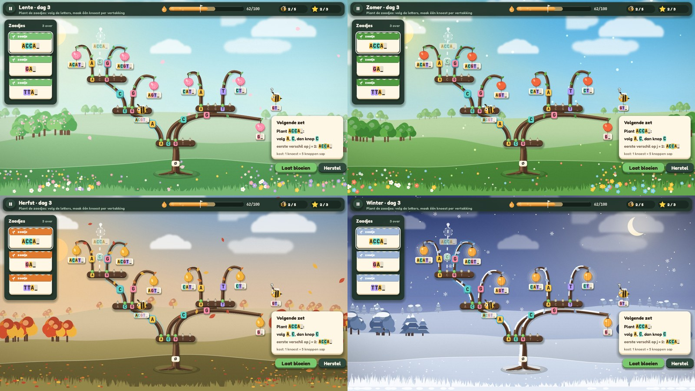

# Trietuin: art & audio direction

> Eigenaar: art & audio director. Voor: gameplay/front-end engineer (scènes, UI, juice) en QA.
> Functionele eisen (wat moet bewegen, lettergroottes, layout, juice-lijst #1–38, audio-tabel) staan in `GDD.md`
> (§4.3, §7). Dit document bepaalt **hoe het eruitziet en klinkt**.
>
> - Referentiescène: `res://games/trietuin/scenes/art_preview.tscn` (code: `scripts/game/tt_art_preview.gd`).
>   Drie pagina's × vier seizoenen. Argumenten na `--`: `season=0..3 page=0..2`. Toetsen: `1`–`4` seizoen, `Tab`
>   volgende pagina. Zonder argumenten wisselt hij zelf.
> - Code die je in de game hergebruikt: `TtPal` (palet, seizoenen, fonts, woorden), `TtDraw` (alle elementen),
>   `TtUi` (knoppen, panelen, thema) en `TtFx` (partikels). Alles is statisch, dus je hoeft niets te instantiëren.
>   Geluid en muziek speelt de game af via `TtSnd` (front-end). Dit document en MANIFEST bepalen namen en mix.
> - Assets: `assets/MANIFEST.md` (wat hoort bij welk event) · `assets/CREDITS.md` (licenties).
> - Screenshots: `design/screens/` (00 = de vier seizoenen naast elkaar).

---

## 1. Stijl: "Betoverde boomgaard", flat vector in code

**Wat Hash & Dash al deed, doen we ook: wat het spel *is*, tekenen we in Godot zelf.** Takken, knoesten, vruchten,
bijen, linten en panelen zijn `draw_*`-calls en `StyleBoxFlat` (zie `TtDraw`). Python genereert enkel wat in code duur
of lastig is: de vier geschilderde achtergronden, de grasrand vooraan, wolken, de partikeltexturen en alle audio.

Waarom zo:
- **Letters en woorden zijn het belangrijkste op het scherm.** Ze moeten scherp blijven op elke grootte en bij elke
  camerazoom, en ze moeten per letter een kleurchip kunnen krijgen. Daarom gebruiken we JetBrains Mono als MSDF-font
  (§3).
- **De boom is dynamisch.** Takken groeien, worden gesnoeid, buigen en splitsen. Een vectortak (bezier + taps
  toelopende polygoon) kan elke vorm aannemen zonder dat je per toestand een sprite nodig hebt.
- **Familie met Hash & Dash.** Zelfde fonts, zelfde "drukbare" knoppen, zelfde chip-principe (inkt op een pastel
  chip), zelfde semantische kleuren, licht van linksboven en afgeronde vormen. Het verschil zit in de wereld:
  H&D is een **koel, donker nachtdepot**, Trietuin een **warme, lichte tuin bij dag** (en een maanlichte winter).

**Moodboard in woorden.** Een boomgaard op een glooiende heuvel, ergens tussen een prentenboek en een
botanische plaat. Zachte luchtverlopen met een laagstaande zon linksboven. Heuvels in drie lagen, met
luchtperspectief: hoe verder, hoe vager. Een donkere, warme bast (chocoladebruin) die op elke lucht contrasteert.
Pastelchips met inktletters, als etiketjes in een zadenwinkel. Papieren labels aan touwtjes. Bijen als knuffelige
bolletjes. De UI is een **donkerbos-groen** paneel met crèmekleurige tekst, zodat ze los komt van de lichte wereld.
Het gevoel is *tactiel, levend en rustig*: niets flitst zonder reden.

**Vormtaal.** Organisch en rond. Takken zijn taps en gebogen. Bladeren zijn amandelvormig. Knoesten, chips en
labels hebben ruim afgeronde hoeken. Hoekig is enkel de UI-geometrie die moet lezen als "werktuig": het lint met
vakjes en de sapbuis. **Licht** valt van linksboven: glanslijn op de lichtkant van elke tak, schaduw 6–8 px naar
rechtsonder (`TtPal.SHADOW_SOFT`) en hooglichtjes linksboven op vruchten en bijen.

---

## 2. Palet

Alle waarden staan als `const` in `scripts/game/tt_pal.gd`. Gebruik altijd de tokens en tik nooit zelf hexwaarden in.

### 2.1 UI (gelijk in alle seizoenen)
| token | hex | gebruik |
|---|---|---|
| `PANEL` | `#24372E` | HUD-balk, zaadjespaneel, menu's (96 % dekkend) |
| `PANEL_HI` | `#30493D` | secundaire knoppen, kopjes |
| `PANEL_LO` | `#1A2A23` | pillen, indexplaatjes, verzonken vakken |
| `SLOT` | `#13201A` | track van de sapbuis |
| `OUTLINE` | `#0E1813` | outline van zwevende tekst (floaters) |
| `TEXT` / `TEXT_DIM` | `#FFF8EA` / `#A9C0AC` | tekst op donker |
| `PAPER` / `PAPER_EDGE` | `#FFF7E6` / `#E6D3AE` | labels, linten, kaartjes, rapport (onderrand = dikte) |
| `INK` / `INK_SOFT` | `#2A2118` / `#7A6853` | **alle** letters op papier of chips / indices, touwtjes |
| `SHADOW` / `SHADOW_SOFT` | groenzwart 32 % / 18 % | slagschaduwen |

### 2.2 Semantisch (identiek aan Hash & Dash)
| token | hex | gebruik |
|---|---|---|
| `OK` | `#3DDC97` | doel-vrucht, "gelijk" in het vergelijkingslint, goed |
| `WARN` | `#FFB020` | eerste verschilpositie j, sap bijna op, rotte vrucht, verlies-streep |
| `ERR` | `#FF5A5F` | **zeer spaarzaam** (enkel als de sap echt op is). Nooit voor "fout antwoord" |
| `INFO` | `#4CC9F0` | leescursor, de knop die de bij nu bekijkt, focusring, bijenpad |
| `STAR` / `STAR_DARK` | `#FFD23F` / `#E09A1B` | sterren, (b,e)-highlight op de slinger |
| `BRAND` / `BRAND_DARK` | `#7BC96F` / `#4E9A47` | hubkleur van Trietuin, primaire knop, scheutjes |

### 2.3 Hout, knoppen, sap, ranken
| token | hex | | token | hex |
|---|---|---|---|---|
| `BARK` | `#6E4C34` | | `SAP` / `SAP_DARK` / `SAP_LIGHT` | `#F2A541` / `#C8761E` / `#FFD58A` |
| `BARK_DARK` (schaduwkant) | `#4B3224` | | `RAFFIA` / `_DARK` (entband, skip) | `#E3C27E` / `#B8934B` |
| `BARK_LIGHT` (glanslijn) | `#9A7451` | | `TENDRIL` / `_DARK` (ranken) | `#86C25A` / `#5E9640` |
| `KNOT` / `KNOT_TOP` / `KNOT_RIM` | `#5A3D2B` / `#7A573D` / `#3E2A1E` | | `ROPE` / `_DARK` (slinger) | `#6E8F3E` / `#4C6A2A` |
| `BUD` / `BUD_DARK` (knop met kind) | `#8FD46B` / `#4E9A47` | | `SNOW` | `#F4F8FF` |
| `BUD_EMPTY` / `_DARK` (NULL) | `#C9BFA4` / `#8E836A` | | | |

### 2.4 Letterchips (het belangrijkste kleursysteem)
Zoals de bitchips in H&D: elke letter staat **in INK op een chip** in haar letterkleur. Dezelfde kleur verschijnt op
de knop in de krans, op de letterchip van de tak, in het label van de vrucht, op het lint en op de kraal van de
slinger. Zo koppel je visueel "kind k_a = tak met chip a = letter a in het woord".

| letter | hex | naam |
|---|---|---|
| `A` / `a` | `#FFC94D` | goud |
| `C` / `c` | `#5CD6C8` | aqua |
| `G` / `g` | `#FF8FAB` | roze |
| `T` / `t` | `#B39DFF` | lavendel |
| `_` | `#E4DCCB` | neutraal (afsluitteken) |
| andere, klein alfabet (≤ 8) | cyclus `#FFC94D #5CD6C8 #FF8FAB #B39DFF #A5E05A #FFA463 #7CC6FE #8EE3B5` in alfabetvolgorde | |
| groot alfabet (a–z, ASCII) | `CHIP_NEUTRAL` `#F1E6CF` voor alles | kleur zegt dan niets meer, de letter wel |

`TtPal.letter_color(ch, alphabet)` regelt dit. De chips zijn pastel en niet-semantisch: een chip mag nooit lijken op
"goed" of "fout". De letter blijft altijd leesbaar zonder kleur (kleurenblind-veilig, §7).

### 2.5 Ternary: kleiner / gelijk / groter
| | hex | vorm | positie |
|---|---|---|---|
| kleiner `<` | `LESS` `#7DB8F0` | badge met `<` | links (−160°) |
| gelijk `=` | `EQUAL` `#7BC96F` | badge met `=`, **dikke tak** | boven |
| groter `>` | `GREATER` `#F5A35C` | badge met `>` | rechts (−20°) |
De kleur is altijd een extra aanwijzing naast het symbool, de positie en de lijndikte. Een lege uitgang is een
opgekrulde rank (NULL), een gebruikte uitgang een rank of tak naar het kind.

### 2.6 Personages
| | tokens |
|---|---|
| bij | `BEE #FFC93C`, `BEE_DARK #E0A21C`, strepen `BEE_STRIPE #3A2A1E`, vleugels wit 55 %, blosjes `BLUSH #FF8FA3` |
| wesp (ontmaskerd) | `WASP #FFD21F`, `WASP_STRIPE #1B1714` (3 brede banden, wenkbrauwen, lange angel) |
| Uil (coach) | `OWL #8B6E58`, `OWL_DARK #634C3C`, buik `OWL_BELLY #EBD7B8`, ogen `SAP`, baret `INK` + kwastje `STAR` |
| Egel (inspecteur) | stekels `HOG #7A5A44` / `HOG_DARK #563E2F`, gezicht `HOG_FACE #EBC9A0`, deerstalker `HAT #B78B52` |
| speurhond | `DOG #C98B52`, `DOG_DARK #7A4E2C`, bles `PAPER` |
| korf / honing | `STRAW #E2B65A` / `#B98A35`, `HONEY #F5A623` / `#C77D12` |
| vuurvliegje | lichaam `#3D3A55`, licht `FIREFLY #E4FF7A` |
| plantpot / stempel | `TERRACOTTA #C8643B` / `#E07B4F`, `STAMP #2F8F57` (groen = goed) |

**Verdachten** (veralgemeende suffixboom). Elke verdachte heeft een kleur **én** een vorm (`TtPal.SUSPECTS`): Vos
`#F28C38` cirkel, Das `#4F8BEA` driehoek, Ekster `#B36AE2` vierkant, Mol `#2FB59A` ruit. Hun vruchten krijgen die
kleur, met het vormpje naast het label (`TtDraw.fruit(..., owner = i)`). Ook hun slinger-touw gebruikt die kleur.

### 2.7 Seizoenen (`TtPal.SEASONS[i]`)
| | Lente (trie) | Zomer (Patricia) | Herfst (ternary) | Winter (suffixboom) |
|---|---|---|---|---|
| lucht boven → horizon | `#8FD3E8` → `#F6F8DE` | `#4FB0E3` → `#FFEFC2` | `#7FA2C6` → `#FAD29A` | `#2F3F73` → `#D8C9E0` (maan, sterren) |
| grond | `#6AAE64` | `#5C9E45` | `#857941` (olijf + gevallen blad) | `#EEF3FA` (sneeuw) |
| blad (3 tinten) | `#7CC274 #93D180 #5FAE60` | `#4F9A3E #65B04A #3E8534` | `#E07A2E #F2B33D #C9472C` | berijpt `#9FB6D6 #C5D4EA #7F98BE` |
| vrucht (body / hoog / laag) | bloesemvrucht `#FF8FAB` `#FFD3DE` `#D9607F` | appel `#F2683C` `#FFB08A` `#C4442A` | peer `#F2B33D` `#FFE49A` `#C47F1C` | lampion `#FFB547` `#FFE7A8` `#D9822B` + gloed |
| accent | bloesem `#F8B8C8` | zonnebloem `#FFC93C` | goud `#F2B33D` | lantaarnlicht `#FFD27A` |
| sfeerdeeltjes | bloemblaadjes `#FFD0DC` | stuifmeel (add) `#FFF0A0` | bladeren (3 kleuren) | sneeuwvlokken wit |
| licht (`light`) | `#FFF6C8` | `#FFF0A0` | `#FFD08A` (laag, goud) | `#FFF4D6` (maan) |
| sneeuw op takken | – | – | – | ja (witte rand op de lichtkant) |

De UI-kleuren veranderen **niet** per seizoen: de HUD blijft herkenbaar. Wat wel per seizoen verandert: de kleur van de
gekartelde band op zaadzakjes (= `leaf[0]`), de vrucht, de blaadjes op takken, de partikels en de muziek.

---

## 3. Typografie (`res://assets/fonts/`, gedeeld met Hash & Dash, OFL)
| rol | font | via |
|---|---|---|
| **woorden, letters, indices, skip, (b,e), getallen** | JetBrains Mono ExtraBold (Bold, Medium voor klein) | `TtPal.MONO`, `MONO_B`, `MONO_M` |
| titels, knoppen, HUD-waarden | Fredoka Bold | `TtPal.UI_BOLD` |
| UI-zinnen, uitleg, ballonnen | Fredoka SemiBold / Medium | `TtPal.UI`, `UI_MED` |

- **Elke string uit de leerstof staat in mono**: woorden (`ACGT_`), letters, posities, `skip 5`, `2,4`, `j = 3`. In
  zinnen meng je de fonts met `TtPal.rich_line(ci, pos, [["Komt ", "ui"], ["cac", "mono"], [" voor?", "ui"]], 28)`.
  Mono-stukken krijgen automatisch letterchips.
- **MSDF.** `TtPal.MONO*` zijn MSDF-kopieën van JetBrains Mono (`multichannel_signed_distance_field = true`, getest).
  Letters blijven haarscherp bij camerazoom 0,6–1,6 (GDD §4.1) en bij schaal-tweens. **Fredoka kan niet als MSDF**:
  de statische instanties hebben overlappende contouren, waardoor een "a" als een "c" rendert. Zet Fredoka-tekst dus in
  de UI-laag (`CanvasLayer`, zoom 1), niet in de gezoomde wereld. In de wereld staat alleen mono, en dat mag.
- **Groottes** (GDD §4.3, bindend): lint 44 · knopletters 26 (|A| ≤ 5), 18 (|A| = 27) · vruchtlabel 24 · skip-plaatje
  28 · (b,e)-bord 22 · slingerparels 40 met index 18 · HUD 28 · titels 64–96. In de preview staan kleinere waarden
  (22–26) om alles op één scherm te krijgen. **Nooit kleiner dan 16 px**, voor woorden nooit kleiner dan 18 px.
  `TtPal.fit_word(n, breedte, max, min)` kiest de grootste maat die past.
- Woorden met kleurchips: gap tussen letters `max(2, 0,10 × grootte)`, chip = letterbreedte + 0,10 × grootte breed en
  1,24 × grootte hoog, met een radius van 0,22 × grootte (`TtPal.word`). Opties: `hi_from..hi_to` (ring, bv. j of het
  bereik (b,e)), `ghost_from..ghost_to` (holle chips: letters die Patricia overslaat), `dim_after` (nog niet gelezen).
- Tekst op donker: `TEXT`, zonder outline. Zwevende tekst (floaters `+10`, `waf!`): Fredoka Bold met
  `outline_size` 8 in `OUTLINE`, zoals in H&D.

---

## 4. Vormtaal en maatvoering (Godot)
| element | maat / radius | schaduw | extra |
|---|---|---|---|
| paneel (HUD, zaadjes, menu) | radius 24–26 | 14–20 / (0, 8–10) | `PANEL` 92–96 % + 2 px lichtere bovenrand (`TtUi.panel_box`) |
| papieren kaart (rapport, uitleg) | 22 | 18 / (0, 10) | onderrand 8 px `PAPER_EDGE` (`TtUi.paper_box`) |
| knop | 20 | 8 / (0, 5) | `border_width_bottom` 6 in kleur −35 %. Hover 3 px omhoog. Druk: squash (1,06; 0,92) → elastisch terug (`TtUi.button`) |
| label / chip / tag | 0,22–0,4 × fontgrootte | 4–5 / (2, 4–5) | onderrand 3–5 px = dikte (`TtPal.sb_thick`) |
| knoest | hoogte 36, radius 18 | 10 / (4, 8) | onderrand 7 px `KNOT_RIM`, lichtlijn bovenaan |
| tak | breedte 24→16 (diepte 0), 18→12, 13→9 | polygoon +(6, 8) in `SHADOW_SOFT` | schaduwkant `BARK_DARK`, glanslijn 52 % naar de lichtkant |
| selectiering | radius + 5 | – | rand 3–4 px, alfa pulseert met sin(6–8 t) |

Gebruik nooit standaard grijze `Panel`'s, het default Godot-thema of puur zwart of wit. Alle `StyleBoxFlat`'s hebben
`anti_aliasing` en `corner_detail = 10` (`TtPal.sb`, gecachet: niet muteren, gebruik `sbn` voor een eigen kopie).

---

## 5. De elementen (functie in `TtDraw`, alles statisch)

### 5.1 Boom
- **Wortel / kiem** `root(ci, ground, top, se, t)`: aardhoopje in de grondkleur, vier wortels, een stam van 44 → 30 px
  en een papieren plaatje met **∅** (de wortel stelt de lege string voor, Definitie 1). Wortel onderaan, de boom
  groeit omhoog (GDD §2.1).
- **Tak** `branch(ci, pts, w0, w1, se, seed, t, leaves, glow, wither)` langs `branch_curve(p0, p1, grow, bend, n, arch)`:
  een bezier die eerst in groeirichting vertrekt. **Takken naar een vrucht krijgen `arch = true`**: ze buigen over en
  komen zijdelings bij de top aan. Zo hangen de vrucht en haar label vrij onder de top en niet over de eigen tak (net
  als een fruitboom). Gebruik `arch` als de top meer dan ~120 px boven de knop ligt. Opties: `glow` = zachte gloed
  eronder (bijenpad, hover, `INFO` 22 %), `wither` 0..1 = **dood hout** (bast en blaadjes verkleuren naar grijsbruin,
  GDD #19). Blaadjes (0–3) wiegen zacht. In de winter ligt er sneeuw op de lichtkant.
- **Knoest = knoppenkrans** `knot(ci, c, letters, used, gap, hi, t, compact)` → geeft de aanhechtpunten terug. Er
  is één knop per letter van het alfabet, in alfabetvolgorde (Definitie 1: kind k_a). Een **bezette knop** is een
  groene open knop met de letter op een chip. Een **lege knop (NULL)** is een gesloten grijs-beige knopje met een
  gedimde letter. Ook lege knoppen kosten sap, en dat moet je zien. `hi` = de knop die de bij nu bekijkt (`INFO`-ring).
  Bij |A| > 8 kies je `compact`: smalle knoppen en enkel de letters van bezette knoppen. Bij ASCII teken je de krans
  niet uit, maar een waaier met de teller "256 knoppen" (GDD §4.3).
- **Letterchip op de tak** `letter_tag(ci, pos, ch, size, alphabet, hi, dim)`, op 45 % van de tak (30 % bij een
  overgebogen tak). Het is een chip in de letterkleur met een donkerder onderrand en INK-letter. `dim` = spooktak.
- **Vrucht = blad** `fruit(ci, tip, se, word, t, state, r, alphabet, label_size, hi_from, hi_to, chips, owner)` hangt aan
  de top van de tak, met een papieren label aan een touwtje (geeft de label-rect terug: klikzone). De vorm volgt het
  seizoen: bloesemvrucht, appel, peer of lampion (gloeit). `state`: 0 normaal · 1 doel (`OK`-ring) · 2 **rot /
  onvindbaar** (grijs, `WARN`-ring, drie vliegjes, GDD #16) · 3 gevonden (gouden gloed). Met `hi_from/hi_to` zet je een
  ring rond positie j in het label.
- **Spooktak / spookvrucht** `ghost_branch`, `ghost_fruit`: een gestippelde, bewegende voorvertoning van wat er zal
  groeien (tutorial-spookhand, hint `F1`, hover op een lege knop).
- **Telbadge** `count_badge(ci, c, n)`: het aantal bladeren onder een top (Oef. 29).

### 5.2 Patricia (zomer)
- **Jaarring-plaatje** `skip_ring(ci, c, skip, pos, r, t, hi)`: een doorgezaagde boomschijf naast de krans, met het
  getal `skip` in mono 28 px en klein `pos k` eronder (GDD §3.2). `hi` = de bij leest nu deze top.
- **Entwikkel** `graft_wrap(ci, pts, f, w)`: raffiabandjes rond de tak waar letters zijn overgeslagen (Patricia-toevoegen
  = enten, GDD #22). **Spookknoppen** `ghost_beads(ci, pts, f0, f1, count)`: holle ringen op de tak, één per
  overgeslagen letter. Ze tonen *dat* er letters zijn, niet *welke*: Patricia bewaart ze niet.
- **Snoeischaar** `shears(ci, c, s, open, grip)`: zilveren lemmeten met oranje handvatten. Ze gaat open bij hover
  (open 0 → 1) en knipt met houtsnippers (`TtFx.snip`).
- `skip_tag` (een raffia-bordje "skip 3" met schaartje) blijft beschikbaar voor in tekst of in de notas-weergave.

### 5.3 Ternary (herfst)
- **Rankknoop** `rank_knot(ci, c, ch, t, exits, r, alphabet, hi)` → geeft de aanhechtpunten [kleiner, gelijk, groter]
  terug. Het is een ronde knoest met een rank errond, in het midden de letterchip, met drie badges `<` `=` `>` (§2.5).
  Een lege uitgang is een opgekrulde rank (`_curl`).
- **Rank** `tendril(ci, p0, p1, col, t)`: een dunne, golvende rank voor kleiner/groter, in `LESS` of `GREATER`. De
  gelijk-uitgang is altijd een gewone tak (`branch`), want het gelijk-kind is "het volgende teken".

### 5.4 Suffixboom (winter)
- **Slinger** `garland(ci, x0, text, gap, se, t, hl_b, hl_e, sag, alphabet, show_idx, cursor)` → geeft de kraalcentra
  terug. Het is een gedraaid touw met blaadjes, en één kraal per teken. Elke kraal is een papieren schijf met een rand
  in de letterkleur (overdag met bloemblaadjes, 's nachts een lichtje). Het afsluitteken `_` is een **sneeuwkristal**
  (zeshoek). Onder elke kraal staat de index op een donker plaatje. Het bereik `hl_b..hl_e` licht goud op, met een
  accolade en een bordje `b,e` eronder. Exact de koppeling van GDD #27: hover op een bord → dezelfde kralen gloeien.
- **(b,e)-bordje** `be_tag(ci, c, b, e, hi)`: papier met een groene rand (de touwkleur). Het toont `b,e` zoals
  Figuur 19 ("0,1"). Bij `hi` wordt het goud, net als de kralen.
- **Letterparels op een boog** `edge_pearls(ci, pts, text, f0, f1)`: winter 4-1, met strings aan de bogen.
- **Mist** `assets/art/shaders/tt_mist.gdshader` op een `ColorRect` boven de slinger (level 4-4). Uniforms:
  `size_px`, `hole_px` (de muis), `hole_radius`, `density`. Zie `_build_page` in de preview.

### 5.5 Personages
- **Bij** `bee(ci, c, s, t, facing, mood, word, alphabet, word_pos, chips, ghost_to, wasp)`. Het is een rond lijfje
  met twee strepen, klapperende vleugels, een blosje en een label aan een draadje. `mood`: 0 vliegt, 1 twijfelt
  (spiraaloogje + "?"), 2 blij (boogoogjes), 3 weggejaagd (><, schudt). In het label: `word_pos` = de letter die ze
  nu leest (`INFO`-ring), de letters erna zijn gedimd, en `ghost_to` = de letters die Patricia overslaat (holle chips).
  De bij volgt de takken op ~42 px boven het takpad (`path_point` / `path_tangent`). Kijkrichting = `facing`.
- **Wesp** = `bee(..., wasp = 0..1)`. Bij 0 is ze niet te onderscheiden van een bij (zo hoort het: GDD §2.1). Tween
  `wasp` 0 → 1 in 0,2 s terwijl het vergrootglas over haar schuift (GDD #14). Dan wordt ze feller geel, krijgt ze drie
  brede zwarte banden, wenkbrauwen en een lange angel, en wordt ze smaller.
- **Korf + koningin** `hive(ci, c, s, t, queen, frown, pulse)`: een strokorf met een vliegopening, en de koningin met
  een kroontje ernaast. `pulse` = de korf pulst bij binnenkomende honing. `frown` = verkeerde honing (GDD #13).
- **De Uil** `owl(ci, c, s, t, talk, cap)`: de coach met een baret ("de professor"). Hij knippert om de 4 s, en
  `talk` 0..1 opent de snavel (koppel aan de tekst). Zet hem in een hoek met een `bubble`, één zin per keer.
- **Inspecteur Egel** `hedgehog(ci, c, s, t, facing, mood)` met een deerstalker en een vergrootglas. `mood` 0–3
  (rustig, "hmm?", blij, verbaasd). **Speurhond** `dog(ci, c, s, t, facing, mood)`: 0 snuffelt, 1 kwispelt (goed),
  2 blaft "waf!" (fout spoor, GDD #30). **Stempel** `stamp(ci, c, "OPGELOST")` is groen en schuin (nooit rood).
- **Vuurvliegje** `firefly(ci, c, s, t, badge)`: de Ukkonen-wijzer p̄ met een badge x̄ (GDD #32).
- **Tekstballon** `bubble(ci, rect, tail)`: papier met een staartje naar de spreker.

### 5.6 Werkbank (onderste zone, GDD §4.3)
- **Lint** `ribbon(ci, left_mid, word, cell, size, cursor, grey_before, mark, mark_col, alphabet, chips, show_idx, t,
  hops)`: een papieren strook met zwaluwstaartjes, één vak per letter en de index eronder (vanaf 0). `cursor` =
  leescursor (`INFO`-ring + pijltje), `grey_before` = kolommen < d gedimd, `mark` = ring rond kolom j, `hops` =
  Patricia-sprongen als boogjes (GDD #20). Gebruik een `cell` van ~58 px voor 44 px letters (GDD).
- **Vergelijkingslint** `compare_ribbon(ci, left_mid, l, s, d, hover, cut, ...)`: twee rijen (l = vrucht, s = zaadje).
  Bij hover kleurt een kolom `OK` (gelijk) of oranje (verschil). Op de gekozen j staan een knipschaartje en een
  `WARN`-ring (GDD #6–7).
- **Zaadzakje** `seed_packet(ci, c, word, se, size, lifted, t, alphabet, label_size)`: een papieren zakje met een
  gekartelde band in de seizoenskleur, een scheutje en "zaadje", en daaronder het woord. Het is de tegenhanger van het
  pakje in H&D.
- **Windrij-kaartje** `card(ci, c, kind, word, t, active)` met kind = seed / bee / wasp / shears / convert / loupe /
  pearl. **Een wesp wordt als bij getekend** (GDD §4.3).

### 5.7 HUD, meters en rapport
- **Sapbuis** `sap_meter(ci, rect, frac, t, opt, ghost, label, loss)`: een glazen buis met amber sap, belletjes en een
  druppelicoon. `ghost` = wat de voorgestelde zet kost (lichter pulserend stuk), `opt` = optimum (grijs vlaggetje,
  pas in de terugblik of vanaf een ★★-run), `loss` = amber verlies-streep (j te laat, GDD §3.1). Onder 20 % pulseert
  er een `WARN`-ring.
- **Pil** `pill(ci, rect, icon, text)` met icon = star / drop / bee / leaf / honey. **Honingpotje** `honey_pot`.
- **Sterren**: `star_slot` (rapport, gevuld of leeg) en `star_flower(ci, c, r, open)`, de ster die als een bloem
  opengaat (GDD #36). Tween `open` 0 → 1 met `TRANS_BACK`, 0,35 s, gestaggerd 0,12 s.
- **Seizoenkaart** `pot(ci, c, "1-2", stars, se, locked, t, hi)`: een terracotta pot met een plantje (bij 3 sterren
  een sterbloem), sterren eronder en een slotje als hij dicht is. **Composthoop** `compost` (GDD #18).
- **Knoppen en panelen**: `TtUi.button(text, kind)` met kind PRIMARY (groen, inkt), SECONDARY (bos), SAP (amber),
  GHOST, DANGER. Verder `TtUi.icon_button("pause")` (Kenney-iconen uit `res://assets/art/icons/`), `TtUi.panel_box()`,
  `TtUi.paper_box()`, `TtUi.label`, `TtUi.mono_label` en `TtUi.pop_in`. Het thema is `TtUi.theme()`.
- **Notas-weergave** (rapport): teken ze **als een papieren figuur uit de lesnotas**. Gebruik `PAPER` als achtergrond,
  INK-lijnen van 2 px, de wortel bovenaan, knoppenrijen `A C G T _` als kaders, mono 22 px en geen schaduwen of
  kleurchips. Enkel de fout en de juiste zet krijgen kleur (WARN / OK). Zo herken je de examenvorm.

### 5.8 Achtergrond en sfeer
- `assets/art/bg/bg_<seizoen>.jpg` (1920×1080) is de geschilderde heuvel: lucht, zon of maan, lichtbundels, drie
  lagen heuvels met boompjes aan de **randen** (het midden blijft rustig voor de boom) en een grondbult in het midden
  voor de kiem (x ≈ 960, y ≈ 890–930). `fg_<seizoen>.png` (1920×180) is een grasrand vooraan. Zet hem **boven** de
  stambasis en onder de UI. Het midden is daar lager en ijler.
- Wolken `cloud_1/2.png` drijven traag (8–18 px/s) naar rechts. 's Nachts staan ze op 35 % dekking, overdag op 75 %.
- Bij een seizoenswissel crossfade je de achtergrond (0,6 s `TRANS_SINE`), met `TtFx.season_wave` en de windgong.

---

## 6. Animatie en juice

### 6.1 Timing en easing (Godot: `tween.set_trans(...).set_ease(...)`)
| soort | trans / ease | duur | opmerking |
|---|---|---|---|
| groeien (tak, krans, vrucht) | `TRANS_BACK` of `TRANS_ELASTIC` / `EASE_OUT` | tak 0,25 s per top, krans 30 ms per knop vanuit het midden, vrucht 0 → 1,1 → 1 in 0,3 s | organisch: altijd een kleine overshoot |
| verschijnen (UI, badge, label) | `TRANS_BACK` / `EASE_OUT` | 0,18–0,25 s | `TtUi.pop_in` |
| verdwijnen | `TRANS_QUAD` / `EASE_IN` | 0,12–0,15 s | altijd sneller dan verschijnen |
| verplaatsen (zaadje langs tak, camera) | `TRANS_CUBIC` / `EASE_IN_OUT` | 0,18–0,45 s | |
| bij langs een tak | per tak 0,12 s, positie via `path_point` op de bezier | – | bob ±3 px (7 Hz), vleugels 40 Hz |
| landen (zaadje op kiem) | `TRANS_BACK` | 0,15 s | squash (1,25; 0,8) → (1; 1) |
| knip / snoei | anticipatie 0,06 s schaar open, dan dicht 0,05 s | – | tak zakt na met `TRANS_BACK` 0,35 s |
| idle | `sin()` in `_process` | 2–4 s periode | blaadjes ±0,1 rad, vruchten ±0,06 rad, Uil ±0,03 rad, boom 0,5° op de maat |
| tellers (honing, sap) | `TRANS_EXPO` / `EASE_OUT` | 0,4–0,8 s | pulse 1,15 → 1 bij aankomst |

Regels (zelfde principes als H&D): gestaggerde reeksen (30–80 ms), squash & stretch met behoud van volume, nooit
lineaire tweens voor zichtbare objecten, en feedback binnen 1 frame (geluid + kleine tik). Slow-mo enkel voor de
wereld. Schermschok gaat via `Juice.shake` (0 / 50 / 100 %, max 4 px). Een tuin schudt weinig.

### 6.2 Kleur en licht als feedback
- **Eén ding tegelijk licht op.** `INFO` = "hier kijk je nu" (bijenpad, leescursor, knop). `OK` = doel of goed.
  `WARN` = let op (j, rot, sap bijna op). Al de rest blijft rustig.
- Fouten krijgen **gevolgen in de tuin**, niet "fout!": de vrucht verkleurt naar grijs (0,8 s) en krimpt 10 %, er
  komen vliegjes, de bij twijfelt of wordt weggejaagd, of het hout verdort. Rood komt niet voor.

### 6.3 Partikels (`TtFx`, CPUParticles2D, witte texturen)
| moment | recept |
|---|---|
| sfeer (altijd, achter de boom) | `TtFx.ambient(parent, seizoen)`: lente bloemblaadjes, zomer stuifmeel (add), herfst bladeren (3 kleuren), winter sneeuw |
| tak/knop groeit | `TtFx.grow`: 7 ronde blaadjes in de bladkleuren + stuifmeel |
| vrucht verschijnt | `TtFx.ripen`: twinkels in het seizoenslicht + blaadjes in de vruchtkleuren |
| snoeien / knippen | `TtFx.snip`: 10 houtsnippers (bast, raffia) met zwaartekracht + 4 blaadjes |
| sap uitgeven | `TtFx.sap`: druppels (`drop.png`) in `SAP` en `SAP_LIGHT` |
| bij vindt de vrucht | `TtFx.found`: gouden twinkels + ring |
| bij verdwaalt / weggejaagd | `TtFx.poof`: zachte grijze pluim (geen rood) |
| seizoenswissel | `TtFx.season_wave`: een golf deeltjes over het scherm |
| sterren (rapport) | `twinkle` + `petal` in `STAR` (blaadjesregen, GDD #36) |
Eigen texturen: `leaf`, `leaf_round`, `petal`, `snowflake`, `pollen`, `drop`, `seed`, `chip`, `firefly`, `twinkle`,
`bubble`. Gedeeld met H&D (`res://assets/art/particles/`): `ring`, `glow`, `sparkle`, `star`, `puff`, `confetti`.

---

## 7. Leesbaarheid en toegankelijkheid (checklist)
1. Letters en woorden zijn **altijd INK op PAPER of op een pastelchip** (contrast ≥ 7:1). Tekst op donker is `TEXT`.
   Nooit gekleurde letters op een gekleurde achtergrond.
2. **Mono voor elke string uit de leerstof.** Vaste kolombreedte maakt posities telbaar, en de `0` met stip is nooit
   een `O`.
3. **Kleurenblind-veilig.** De letter staat altijd op de chip. Kleiner, gelijk en groter hebben een symbool, een
   positie en een lijndikte. Verdachten hebben een kleur én een vorm. Rot is grijs + ring + vliegjes. Het
   bijenpad heeft gloed + ring + een pijltje op het lint. Doel en verschil hebben ook een ring of icoon.
4. Woorden in de gezoomde wereld zijn MSDF (§3) en blijven scherp. Zet nooit Fredoka in de gezoomde wereld.
5. Labels overlappen geen takken: overgebogen takken naar vruchten (§5.1), labels hangen in vrije ruimte. Bij een
   drukke boom schaal je de **layout** (toppenafstand 110 → 70 px, GDD §4.3), niet de lettergrootte onder 18 px.
6. Achtergronden houden het midden rustig en laag in contrast. De bast (`#6E4C34`) contrasteert op elke lucht. In de
   winter ligt er sneeuw op de takken, maar de bast blijft donker.
7. Partikels staan nooit vóór een label: `z_index` sfeer < boom < labels < UI.

---

## 8. Audio direction

**Klankkleur.** Akoestisch, houtachtig en zacht: marimba, getokkelde snaren, houtfluit, celesta en speeldoos. SFX zijn
"dingen uit een tuin" (hout, papier, druppels, bladeren, bijen) met een beetje galm. **Fouten klinken niet als straf**:
een zachte zoem (`buzz_soft`), een doffe bonk of een hmm. Er zit geen buzzer in. De familie met H&D zit in de UI:
dezelfde Kenney-klikjes via `Sfx.ui("click")` en dezelfde bus-indeling (`Music`, `SFX`, `UI`, aangemaakt door de
autoload `Sfx`). In de game speelt **`TtSnd`** (`scripts/game/tt_snd.gd`, front-end) de Trietuin-bestanden af op
die bussen: `TtSnd.play("fruit_plop")`, `.letter(ch, letters)`, `.note(ch)`, `.season_music(s)`, `.bloom_layer(on)`,
`.jingle(n)` en `.loop(key, "bee_buzz_loop", on)`. Gebruik **niet** `Sfx.play_track`, want die kent enkel de
H&D-nummers.

**Mix.** Muziek: basis −6 à −8 dB, bloeilaag op hetzelfde niveau erbij (bij Bloei en rapport), fade-in 0,8 s,
fade-out 1,2 s. Sfeerlus −14 à −16 dB. Gameplay-SFX 0 dB, UI −6 dB, zoemlus van de bij −16 dB (stereo pan volgt de bij). Herhaalde geluiden
(letter, plop, druppel) krijgen een `pitch_scale` random 0,94–1,06, max 4 tegelijk. **Lettertik**: één sample, en
de toonhoogte volgt de letterpositie pentatonisch: `pitch_scale = pow(2, [0, 2, 4, 7, 9, 12, 14, 16][i % 8] / 12.0)`.
Zo klinkt een woord als een melodietje. **Sapdruppel**: `pitch_scale` 0,8 + 0,4 × sapniveau (zakt met het niveau).

**Muziek per seizoen.** Twee synchrone, naadloze lussen per seizoen: `tt_<s>_loop` (basis, altijd) en
`tt_<s>_bloom_loop` (bloei). Start ze op hetzelfde moment en fade enkel het volume. Dat is GDD §7.2.
| | tempo, toon | basis | bloei |
|---|---|---|---|
| Lente | 92 BPM, F-majeur | marimba-arpeggio's, getokkelde bas, zachte kick + shaker | houtfluit-melodie, glockenspiel-sterretjes |
| Zomer | 100 BPM, G-majeur | akoestische gitaarslagen (Karplus-Strong), bas, shaker | fluitlead (pentatonisch), handclaps |
| Herfst | 84 BPM, D-dorisch | pizzicato-strijkers, celesta, brushes | cello-melodie |
| Winter | 76 BPM, A-mineur/C | speeldoos, zachte pads, bas | "koortje" (formant-pad), sleebelletjes |
| Titel/kaart | 84 BPM | rustige lente zonder slagwerk (`tt_title_loop`) | – |
| Finale | 90 BPM, C-pentatonisch | pad + pols (`tt_finale_loop`). De parelnoten `note_a/c/g/t/b/end` (C, E, G, A, D, hoge C) passen er altijd op | – |
| Rapport | – | `tt_jingle_1/2/3` (naar het aantal sterren) | – |
Om ergernis te vermijden zijn de lussen lang (38–51 s, 16 maten) en hebben ze een zachte attack en weinig hoge tonen.
De melodie zit enkel in de bloeilaag. De basislagen zijn genormaliseerd op dezelfde luidheid (RMS −19 dBFS).

**Sfeerlussen** (16 s, mono): lente vogels in de verte, zomer krekels, herfst wind en ritselende bladeren, winter
zachte wind, sneeuwkraak en verre belletjes. Volume −14 dB onder de muziek.

**Event → geluid**: zie `assets/MANIFEST.md` (één regel per GDD-gebeurtenis).

---

## 9. Do / Don't
- **Do**: letters in mono, INK op een chip. Takken naar vruchten overbuigen. Eén gloed tegelijk. Licht van
  linksboven. Gevolgen in de tuin in plaats van rood. Seizoenstokens uit `TtPal.season(i)`. Alles via `TtDraw`.
- **Don't**: Fredoka in de gezoomde wereld. Gekleurde letters. Rood voor fouten. Tekst onder 16 px. Default-thema of
  grijze panelen. Tweens zonder easing. Emoji in de UI (de windrij-icoontjes zijn getekend: `card`). Partikels over
  labels. Een drukke achtergrond achter de kroon.

## 10. Eerlijke status
Sterk: de leesbaarheid van woorden en letters (ook bij zoom), de koppeling via letterkleuren (knop ↔ tak ↔ label ↔
lint ↔ kraal), de seizoenen die samen één familie vormen, de overgebogen fruittakken, de personages (de wesp ziet er
echt als een bij uit tot ze ontmaskerd wordt) en het audiopakket met twee lagen per seizoen.
Nog te doen of te bewaken door de front-end:
- de layout van echte, grote bomen (`TtLayout`). De preview is handmatig geplaatst, dus check de overlap van labels
  bij brede kransen;
- de animaties zelf. De preview toont enkel idle-beweging, partikels en seizoenswissels. De timings staan in §6;
- de mist-shader (`tt_mist.gdshader`) is eenvoudig. Op de lichte winterachtergrond is hij subtiel, dus verhoog
  `density` of kies een koelere `mist_color` als het te zwak is;
- de muziek is procedureel gegenereerd en niet beluisterd door een mens. Laat QA de lussen een paar minuten aan
  laten staan. Vervelen ze, verlaag dan de bloeilaag of wissel tussen basis en titel;
- de speurhond staat in de GDD (#30, §3.4). Hij is getekend (`dog`), maar klein. Vergroot hem ×1,3 als hij een rol
  speelt.
